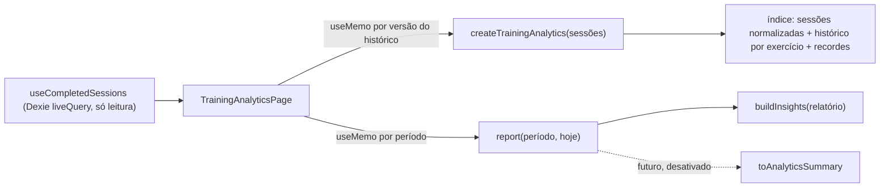

# Análise de treinos (motor de analytics)

IronTrack 2.0 · Fase 01 · Prompt 08. Descreve o motor local que transforma as sessões concluídas em
indicadores de desempenho, tendências e insights. Tudo roda no aparelho, sem rede e sem IA: os números são
calculados por funções puras e determinísticas. A IA poderá, no futuro, **explicar** esses indicadores, mas
nunca calculá-los.

Código: `src/modules/analytics/` (domínio e aplicação), `src/pages/TrainingAnalyticsPage.tsx` (tela, rota
`#/evolucao/desempenho`). Testes: `tests/unit/analytics.test.ts`, `tests/unit/analytics-ui.test.tsx`,
bloco "arquitetura do motor de analytics" em `tests/unit/architecture.test.ts` e `e2e/analytics.spec.ts`.

## 1. Arquitetura

```
src/modules/analytics/
  index.ts                         API pública: importe sempre '@/modules/analytics'
  domain/types.ts                  tipos do relatório, tendência, recordes, insights
  domain/periods.ts                períodos, janelas, semanas (aritmética de calendário)
  domain/metrics.ts                normalização, pontos por exercício, recordes, agregações
  domain/trends.ts                 classificação de tendência
  application/TrainingAnalyticsService.ts  índice + relatórios por período
  application/InsightsEngine.ts            regras de insights
  application/summary.ts                   resumo agregado para uso futuro pelo assistente
```



Regras (testadas):

- domínio e aplicação **sem React, Dexie, banco, hooks, rede, armazenamento ou IA**;
- dependências permitidas: o próprio módulo, `lib/dates` e a **API pública** do treinamento
  (`@/modules/training`: tipos de sessão e `estimate1RM`). É a única exceção à regra "domínio não importa
  outro domínio": analytics é um modelo de leitura sobre o treinamento. Treinamento não conhece analytics;
- nenhum método de escrita, nenhum `fetch`, nenhuma URL ou variável de ambiente;
- IA, assistente, integrações, banco, hooks e `lib` não importam analytics (o resumo não é usado);
- a página é carregada sob demanda numa sub-rota de Evolução; a navegação continua com 6 itens.

A leitura de dados usa o hook existente `useCompletedSessions` (porta de leitura já usada pelas outras
telas). Não há nova consulta ao Dexie nem nova tabela.

## 2. Fontes de dados

Somente `sessions` com `status = 'completed'`. Dentro de cada sessão, `exercises[].sets[]`.

| Entra | Não entra |
| --- | --- |
| sessão concluída com `startedAt` numérico finito | sessão `active` (em andamento) ou `discarded`; `startedAt` inválido |
| série `status = 'done'`, tipo `normal` ou `drop` | aquecimento, séries `pending` (planejadas) ou `skipped` |
| repetições numéricas finitas > 0 | repetições vazias, zero, negativas, `NaN` ou infinitas (contadas em `quality.invalidRepSets`) |

Rotinas **não** são lidas: cada sessão guarda o próprio exercício (chave, nome, grupo, equipamento). Por
isso rotinas excluídas não afetam a análise. A identidade do exercício é `exerciseKey`; em registros antigos
sem chave usa-se o nome em minúsculas. O nome exibido é o mais recente (renomear na ficha não quebra a
série). O mesmo exercício duas vezes na sessão vira uma observação só.

## 3. Definição das métricas

| Métrica | Definição |
| --- | --- |
| Sessões concluídas | sessões aceitas com data local dentro da janela |
| Dias distintos | datas locais diferentes com sessão |
| Semanas | semanas (segunda a domingo) tocadas pela parte coberta da janela |
| Semanas ativas | semanas com pelo menos uma sessão |
| Média semanal | sessões ÷ (dias cobertos ÷ 7); **não calculada** com menos de 7 dias cobertos |
| Séries realizadas | séries aceitas (seção 2); por exercício, por semana/mês e por grupo muscular |
| Séries com carga / sem carga | com carga válida (> 0) / sem carga (peso corporal, vazia, zero ou inválida) |
| Volume de carga | Σ carga × repetições, só séries com carga válida |
| Carga máxima | maior carga válida da sessão para o exercício (com as repetições daquela série) |
| 1RM estimado | melhor `estimate1RM(carga, reps)` da sessão, só séries de 1 a 12 repetições com carga |
| Maior volume numa série | maior carga × repetições numa única série |
| Repetições sem carga | maior número de repetições numa série sem carga |

**Dias cobertos.** Quando o histórico começa depois do início da janela (ex.: começou a usar há 10 dias e
escolheu 30 dias), as médias usam só a parte coberta (`report.covered`). O período "Todo o histórico" vai da
primeira sessão concluída até hoje.

**Grupo muscular.** É o texto da ficha (`muscleGroup`). Séries de exercícios com grupo vazio não são
atribuídas a nenhum grupo: são contadas em `unclassifiedSets` e a tela avisa.

## 4. Fórmulas

- Volume da série: `carga × repetições` (kg).
- 1RM estimado (Epley, a mesma função `estimate1RM` dos recordes existentes):
  `reps = 1 → carga`; `reps > 1 → carga × (1 + reps / 30)`; só para `1 ≤ reps ≤ 12`.
- Comparação: `diff = atual − anterior`; `pct = diff ÷ anterior × 100`, **null** quando o anterior é zero.
- Regularidade: coeficiente de variação `CV = desvio-padrão populacional ÷ média` das sessões por semana
  nas semanas completas (seção 6).
- Tendência: seção 8.

### Divergência de 1RM existente (não alterada)

Há duas fórmulas no domínio de treinamento, registradas no P03 (`docs/ARQUITETURA.md`, seção 11):

| Onde | 1 repetição | Usado por |
| --- | --- | --- |
| `stats.ts › exerciseSeries` (Epley inline) | carga × 1,033 | gráfico "Evolução por exercício" da aba Treino |
| `volume.ts › estimate1RM` | a própria carga | recordes pessoais (`computeRecords`, `sessionPRs`) |

Nesta etapa **nenhuma delas mudou** (teste de caracterização mantido, e um teste novo confirma a divergência).
O motor novo usa **`estimate1RM`**: uma série de 1 repetição é a medida direta do 1RM, e é a fórmula dos
recordes, então recordes e análise concordam. Além disso o motor limita a estimativa a 12 repetições.
Consequência: o 1RM da página nova pode diferir do gráfico antigo em séries de 1 repetição (≈ 3,3%) e em
séries acima de 12 repetições (o gráfico antigo estima; o novo não). Unificar o gráfico antigo fica para uma
etapa que aceite mudar números exibidos.

## 5. Tratamento de unidades

- Pesos estão sempre em **kg** no banco (carga externa total). O motor só trabalha em kg; a tela converte
  para lb quando o usuário escolhe lb (`useUnits`). Os textos dos insights não trazem pesos: as cargas vão
  na evidência numérica, em kg, e a tela formata na unidade escolhida.
- Peso corporal: a massa do corpo **nunca** é somada. Séries sem carga contam em séries e repetições, não
  em quilos. Com carga extra (ex.: barra com anilha), só a carga externa entra no volume.
- Carga negativa, `NaN` ou infinita: a série continua contando como realizada (se as repetições forem
  válidas), mas fica fora do volume e das cargas, e é contada em `quality.invalidLoadSets`.

## 6. Critérios de comparabilidade

- **Datas.** A data de uma sessão é a data local (fuso do aparelho) de `startedAt`, como no restante do
  app. Toda a aritmética de dias (janelas, semanas, meses) é feita sobre datas de calendário em UTC, o que a
  torna imune a horário de verão. Semana: segunda a domingo.
- **Janelas.** "Últimos N dias" = hoje e os N − 1 dias anteriores. A janela anterior tem a mesma duração e
  termina no dia anterior ao início da atual.
- **Comparação só entre períodos equivalentes.** Exige que a primeira sessão do histórico seja no início
  da janela anterior ou antes; caso contrário a comparação é marcada como indisponível
  (`historico_insuficiente`) e nada é comparado. "Todo o histórico" não tem período anterior.
- **Semanas completas.** A regularidade usa só semanas inteiramente dentro da parte coberta (a semana
  atual, ainda em andamento, fica de fora). Exige 4 semanas completas.
- **Séries comparáveis.** Faixas de repetições `1–5`, `6–12` e `13+` (`topLoadByBand`). A tendência usa o
  1RM estimado (que normaliza séries de 1 a 12 repetições); quando o exercício só tem séries de 13 ou mais
  repetições, usa a maior carga nessa faixa; sem carga, usa repetições. Nunca compara uma série pesada de 1
  repetição com uma de 15 como equivalentes.
- **Gráficos.** Até 182 dias cobertos, barras por semana; acima disso, por mês. O gráfico de exercício
  mostra no máximo 120 pontos (acima disso, o maior valor de cada bloco consecutivo).

## 7. Recordes pessoais

Por exercício, sobre **todo o histórico** (recorde absoluto):

- maior carga (com repetições e data);
- maior volume numa única série;
- melhor 1RM estimado (só 1 a 12 repetições; identificado como estimativa na tela);
- mais repetições sem carga.

Empates não renovam o recorde (fica a primeira data). Um **novo recorde de carga** só é declarado quando
supera a melhor marca de pelo menos **2 sessões anteriores com carga** (`MIN_PRIOR_SESSIONS_FOR_RECORD`): a
primeira e a segunda sessão nunca são "recorde". O histórico de recordes guarda a marca anterior superada.

Recorde absoluto × melhor do período: o relatório traz `periodBest` (melhor marca **dentro** da janela) e
`records` (todo o histórico) separados. O insight "novo recorde" só aparece quando o recorde foi batido
dentro do período **e** continua sendo o recorde absoluto.

`computeRecords`/`sessionPRs` (tela de treino e histórico) não mudaram e seguem sua regra própria (1 sessão
anterior basta).

## 8. Tendências

Para cada exercício com sessões no período, `computeTrend` classifica em **positiva**, **estável**,
**queda** ou **dados insuficientes**:

1. Observações = um valor por sessão (seção 6), em ordem cronológica.
2. **Insuficiente** se houver menos de **4** observações (`poucas_sessoes`), ou se a primeira e a última
   estiverem a menos de **14 dias** (`intervalo_curto`), ou se não houver métrica (`sem_metrica`). Duas
   sessões isoladas nunca geram estabilidade nem queda.
3. Divide em duas metades do mesmo tamanho (com quantidade ímpar, a do meio sai) e calcula a média de cada
   uma: `variação % = (média2 − média1) ÷ média1 × 100`.
4. **Ruído natural:** `EP = √(s1²/k + s2²/k)` (variância amostral de cada metade, `k` observações por
   metade). Limiar = maior entre o mínimo da métrica (**2,5%** para cargas, **5%** para repetições) e
   `2 × EP ÷ média1 × 100`. Quanto mais as sessões oscilam, maior o limiar.
5. `variação > limiar` → positiva; `variação < −limiar` → queda; senão estável.
6. **Confiança** (suficiência dos dados, não certeza estatística): alta com ≥ 8 observações, ≥ 28 dias e
   nenhum intervalo maior que 21 dias; média com ≥ 6 observações e intervalos ≤ 28 dias; baixa no resto.

Limites: é uma comparação descritiva, não um teste de hipótese formal; não modela periodização, troca de
técnica ou de equipamento; 1RM estimado é estimativa. **Queda não é interpretada como perda de força**: o
texto diz explicitamente que técnica, faixa de repetições, cansaço do dia ou uma fase mais leve também mudam
a carga registrada. O motor não fala em overtraining nem em descanso.

## 9. Insights

`buildInsights(relatório)` aplica regras fixas, nesta ordem:

| ID | Regra | Tom |
| --- | --- | --- |
| `dados.sem_treinos` / `dados.periodo_vazio` | nenhum treino no histórico / no período (e nada mais é gerado) | informativo |
| `frequencia.comparacao` | sessões × período anterior equivalente | positivo se mais; neutro se menos/igual |
| `frequencia.comparacao_indisponivel` | histórico não cobre o período anterior | informativo |
| `frequencia.media_semanal` | média semanal (quando calculável) | informativo |
| `volume.comparacao` | volume × anterior; < 5% = semelhante | positivo se maior; neutro se menor/igual |
| `volume.series_sem_carga` | há séries sem carga no período | informativo |
| `consistencia.regularidade` | CV ≤ 0,35 estável; senão "variou" | positivo / neutro |
| `recorde.carga.<exercício>` | recorde absoluto batido no período (até 3) | positivo |
| `carga.tendencia.<exercício>` | positiva, estável ou queda (até 3 de cada) | positivo / neutro / neutro |
| `carga.tendencia.insuficiente` | exercícios sem dados suficientes | informativo |
| `dados.valores_invalidos` | séries com valores inválidos no histórico | informativo |

Cada insight tem `id`, `type`, `tone`, `title`, `description`, `period`, `range`, `metric` (caminho no
relatório), `evidence` (números com unidade) e `confidence` (tendências). Os textos são neutros: sem
diagnósticos, sem prescrição de treino ou dieta, sem alarmismo e sem culpa (um teste varre as mensagens por
termos proibidos). Semanas sem treino entram como zero "sem penalidade".

## 10. Limitações

- Data da sessão = data de início; um treino que atravessa a meia-noite conta no dia em que começou.
- Fuso: se o aparelho mudar de fuso, a data local de sessões antigas pode mudar (igual ao resto do app).
- Grupo muscular depende do texto da ficha; grupos escritos de formas diferentes contam separados.
- Exercícios unilaterais, isométricos (tempo) e cardio não têm métrica própria; tempo não é registrado.
- Drop-sets entram como séries normais.
- Sem cache persistente: o índice é refeito quando o histórico muda (seção 12).
- O gráfico antigo da aba Treino continua com sua fórmula de 1RM (seção 4).

## 11. Privacidade

Nada sai do aparelho e nada é gravado: o motor só lê sessões já carregadas e devolve objetos em memória.
Não há chamada de rede, nem uso de IA, nem nova tabela, nem alteração de registros (testado na tela com o
banco fictício: o conteúdo é idêntico antes e depois). Os testes e o E2E usam apenas dados fictícios.

## 12. Desempenho

- `createTrainingAnalytics` normaliza o histórico **uma vez** por versão (O(séries)) e monta o histórico e os
  recordes por exercício. A tela guarda o índice em `useMemo` ligado ao array de sessões do `liveQuery`.
- Trocar de período só reagrega a janela: as sessões e os pontos estão em ordem e a janela é recortada por
  **busca binária**. Nenhum laço quadrático.
- Gráficos: barras por mês acima de 182 dias; no máximo 120 pontos por exercício.
- Teste com 3 anos de histórico (624 sessões × 6 exercícios × 4 séries): índice + 5 relatórios + insights
  abaixo de 2 s no ambiente de testes (na prática, dezenas de milissegundos).

## 13. Testes

- `tests/unit/analytics.test.ts`: frequência, viradas de semana/mês/ano, fuso (São Paulo × Tóquio) e
  horário de verão, sessões em andamento, séries incompletas, volume por exercício/sessão/semana/período,
  séries e grupos, evolução de carga, faixas comparáveis, comparação de períodos, recordes (empate,
  absoluto × período, mínimo de sessões), sem carga, peso corporal com carga, dados insuficientes, registros
  antigos, rotinas excluídas, valores inválidos (sem `NaN`/`Infinity`), ausência de dados, imutabilidade da
  entrada, insights (positiva, estável, queda, insuficiente, evidência, ausência de diagnóstico e prescrição,
  determinismo), resumo sem identificadores e desempenho.
- `tests/unit/analytics-ui.test.tsx`: estados vazios (sem treino, só em andamento, um treino, só peso
  corporal), troca de período sem gravar, seleção de exercício.
- `tests/unit/architecture.test.ts`: limites do módulo (seção 1).
- `e2e/analytics.spec.ts` (Android 360 px e desktop): página vazia, dados fictícios por restauração de
  backup, períodos pelo teclado sem navegação, gráficos, seleção de exercício, peso corporal, navegação de 6
  itens com "Evolução" ativa, ausência de rolagem horizontal e de `NaN`.

## 14. Integração futura com IA

`toAnalyticsSummary(relatório, insights)` produz `TrainingAnalyticsSummary`
(`irontrack.analytics-summary.v1`): só agregados (contagens, média semanal, volume em kg arredondado,
variações percentuais, até 8 grupos e 10 exercícios com tendência e melhor carga do período, títulos dos
insights). **Não** inclui `profileId`, IDs internos, datas exatas, fotos, notas nem sessões.

Hoje ele **não é usado**: o módulo de IA, o `ContextBuilder`, o assistente e suas integrações não importam
analytics (regra testada), e o fluxo de consentimento não mudou. Para ligar no futuro: criar uma categoria
explícita de consentimento (ex.: "indicadores de desempenho"), mostrar o resumo na prévia como as demais
categorias e só então registrá-lo em `src/integrations/ai/contextSources.ts`. A IA continuaria apenas
explicando números calculados aqui.
