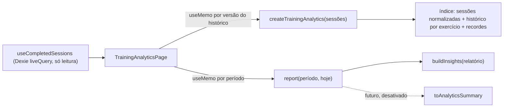

# Análise de treinos (motor de analytics)

IronTrack 2.0 · Fase 01 · Prompt 08, ampliado no Prompt 09 (normalização muscular, classificação de
exercícios, 1RM canônico, contratos por modalidade e explicações dos indicadores, seções 15 a 22). Descreve o motor local que transforma as sessões concluídas em
indicadores de desempenho, tendências e insights. Tudo roda no aparelho, sem rede e sem IA: os números são
calculados por funções puras e determinísticas. A IA poderá, no futuro, **explicar** esses indicadores, mas
nunca calculá-los.

Código: `src/modules/analytics/` (domínio e aplicação), `src/pages/TrainingAnalyticsPage.tsx` (tela, rota
`#/evolucao/desempenho`). Testes: `tests/unit/analytics.test.ts`, `tests/unit/analytics-advanced.test.ts` (P09), `tests/unit/analytics-ui.test.tsx`,
bloco "arquitetura do motor de analytics" em `tests/unit/architecture.test.ts` e `e2e/analytics.spec.ts`.

## 1. Arquitetura

```
src/modules/analytics/
  index.ts                         API pública: importe sempre '@/modules/analytics'
  domain/types.ts                  tipos do relatório, tendência, recordes, insights
  domain/periods.ts                períodos, janelas, semanas (aritmética de calendário)
  domain/metrics.ts                normalização, pontos por exercício, recordes, agregações
  domain/trends.ts                 classificação de tendência
  domain/muscles.ts                normalização de grupos musculares (P09)
  domain/classification.ts         classificação analítica do exercício (P09)
  domain/oneRepMax.ts              contrato canônico de 1RM + adaptador do gráfico antigo (P09)
  domain/modalities.ts             tempo, cardio, lados e peso corporal: cálculos puros (P09)
  application/TrainingAnalyticsService.ts  índice + relatórios por período
  application/indicators.ts                explicações dos indicadores e análises disponíveis (P09)
  application/InsightsEngine.ts            regras de insights
  application/summary.ts                   resumo agregado para uso futuro pelo assistente
```



Regras (testadas):

- domínio e aplicação **sem React, Dexie, banco, hooks, rede, armazenamento ou IA**;
- dependências permitidas: o próprio módulo, `lib/dates` e a **API pública** do treinamento
  (`@/modules/training`: tipos de sessão e `estimate1RM`). É a única exceção à regra "domínio não importa
  outro domínio": analytics é um modelo de leitura sobre o treinamento. Treinamento não conhece analytics;
- nenhum método de escrita, nenhum `fetch`, nenhuma URL ou variável de ambiente;
- IA, assistente, integrações, banco, hooks e `lib` não importam analytics (o resumo não é usado);
- a página é carregada sob demanda numa sub-rota de Evolução; a navegação continua com 6 itens.

A leitura de dados usa o hook existente `useCompletedSessions` (porta de leitura já usada pelas outras
telas). Não há nova consulta ao Dexie nem nova tabela.

## 2. Fontes de dados

Somente `sessions` com `status = 'completed'`. Dentro de cada sessão, `exercises[].sets[]`.

| Entra | Não entra |
| --- | --- |
| sessão concluída com `startedAt` numérico finito | sessão `active` (em andamento) ou `discarded`; `startedAt` inválido |
| série `status = 'done'`, tipo `normal` ou `drop` | aquecimento, séries `pending` (planejadas) ou `skipped` |
| repetições numéricas finitas > 0 | repetições vazias, zero, negativas, `NaN` ou infinitas (contadas em `quality.invalidRepSets`) |

Rotinas **não** são lidas: cada sessão guarda o próprio exercício (chave, nome, grupo, equipamento). Por
isso rotinas excluídas não afetam a análise. A identidade do exercício é `exerciseKey`; em registros antigos
sem chave usa-se o nome em minúsculas. O nome exibido é o mais recente (renomear na ficha não quebra a
série). O mesmo exercício duas vezes na sessão vira uma observação só.

## 3. Definição das métricas

| Métrica | Definição |
| --- | --- |
| Sessões concluídas | sessões aceitas com data local dentro da janela |
| Dias distintos | datas locais diferentes com sessão |
| Semanas | semanas (segunda a domingo) tocadas pela parte coberta da janela |
| Semanas ativas | semanas com pelo menos uma sessão |
| Média semanal | sessões ÷ (dias cobertos ÷ 7); **não calculada** com menos de 7 dias cobertos |
| Séries realizadas | séries aceitas (seção 2); por exercício, por semana/mês e por grupo muscular |
| Séries com carga / sem carga | com carga válida (> 0) / sem carga (peso corporal, vazia, zero ou inválida) |
| Volume de carga | Σ carga × repetições, só séries com carga válida |
| Carga máxima | maior carga válida da sessão para o exercício (com as repetições daquela série) |
| 1RM estimado | melhor `estimate1RM(carga, reps)` da sessão, só séries de 1 a 12 repetições com carga |
| Maior volume numa série | maior carga × repetições numa única série |
| Repetições sem carga | maior número de repetições numa série sem carga |

**Dias cobertos.** Quando o histórico começa depois do início da janela (ex.: começou a usar há 10 dias e
escolheu 30 dias), as médias usam só a parte coberta (`report.covered`). O período "Todo o histórico" vai da
primeira sessão concluída até hoje.

**Grupo muscular.** É o texto da ficha (`muscleGroup`). Séries de exercícios com grupo vazio não são
atribuídas a nenhum grupo: são contadas em `unclassifiedSets` e a tela avisa. `report.muscleGroups` continua
com o texto exato (P08, compatibilidade); desde o P09 a tela usa `report.muscleDistribution`, com nomes
normalizados (seção 15).

## 4. Fórmulas

- Volume da série: `carga × repetições` (kg).
- 1RM estimado (Epley, a mesma função `estimate1RM` dos recordes existentes):
  `reps = 1 → carga`; `reps > 1 → carga × (1 + reps / 30)`; só para `1 ≤ reps ≤ 12`.
- Comparação: `diff = atual − anterior`; `pct = diff ÷ anterior × 100`, **null** quando o anterior é zero.
- Regularidade: coeficiente de variação `CV = desvio-padrão populacional ÷ média` das sessões por semana
  nas semanas completas (seção 6).
- Tendência: seção 8.

### Auditoria das fórmulas de 1RM (P09)

Há três comportamentos no código. **Nenhum cálculo antigo foi alterado** (testes de caracterização mantidos).

| | Gráfico antigo (`stats.ts › exerciseSeries`) | Recordes (`volume.ts › estimate1RM`) | Analytics (P08/P09, `oneRepMax.ts › canonicalE1rm`) |
| --- | --- | --- | --- |
| Fórmula | Epley inline: `carga × (1 + reps ÷ 30)` | Epley; 1 rep = carga | Epley; 1 rep = carga (método `epley-1a12-v1`) |
| Intervalo de repetições | qualquer número | qualquer número > 0 | inteiro de 1 a 12; acima disso **não estima** |
| 1 repetição | carga × 1,0333… | carga | carga (`kind: 'direta'`) |
| Carga inválida (0, negativa, vazia) | 0 | 0 | recusada com motivo (`carga_invalida`), nunca 0 |
| Repetições inválidas | entram na conta | 0 | recusadas (`repeticoes_invalidas`); fracionárias também |
| Unidade | kg (lb só na tela) | kg | kg; entrada em lb convertida com `KG_PER_LB` exato |
| Arredondamento | tela: 0,1 após converter | tela: 0,1 | nenhum no cálculo; só na exibição (0,1) |
| Usado por | gráfico "Evolução por exercício" da aba Treino | tabela de recordes da aba Treino, `computeRecords`, `sessionPRs` (fim do treino e detalhe da sessão) | página Desempenho: pontos, recordes de 1RM e tendência |

Exemplos (100 kg): 1 rep → 103,3 / 100 / 100; 10 reps → 133,3 nos três; 15 reps (50 kg) → 75 / 75 / sem
estimativa. Diferença do gráfico antigo frente ao canônico: +3,33% em séries de 1 repetição; acima de 12
repetições o gráfico antigo (e o recorde de 1RM antigo) estimam e o canônico não. `HomePage` usa
`exerciseSeries` só para carga e repetições (não usa o 1RM).

**Contrato canônico** (`canonicalE1rm(carga, reps, unidade)`): devolve `{ ok, valueKg, method, kind, loadKg,
reps }` ou `{ ok: false, method, reason }`. Precisão completa (sem arredondar); o método fica identificado em
cada resultado, em `ExerciseSummary.e1rmMethod` e na tela ("Método: Epley (1 a 12 repetições)").
`sameMethodOnly` filtra uma série de estimativas para um único método: uma tendência nunca mistura métodos.
O motor do P08 passou a usar esse contrato; para repetições inteiras o resultado é idêntico ao do P08.

**Adaptador de compatibilidade.** `legacyChartE1rm` reproduz exatamente o gráfico antigo (testado contra
`exerciseSeries`) e `compareWithLegacyChart` calcula a diferença série a série. Servem para documentação e
testes; o gráfico antigo continua chamando o próprio código.

**Proposta de migração da apresentação (não executada, aguarda autorização).** Unificar o gráfico antigo
mudaria números já vistos pelo usuário (séries de 1 repetição caem ≈ 3,2%; séries acima de 12 repetições
deixam de ter 1RM). Proposta: (1) trocar o cálculo do gráfico antigo e o `best1RM` de `computeRecords` por
`canonicalE1rm`, mantendo `estimate1RM` exportado; (2) mostrar o nome do método nos dois lugares; (3) exibir
uma nota única "o 1RM estimado passou a usar o método Epley 1–12" na primeira abertura; (4) atualizar os testes
de caracterização em um commit separado que documente a mudança. `sessionPRs` usa o 1RM para declarar
recorde: com o limite de 12 repetições, séries longas deixariam de gerar recorde de 1RM (recorde de carga
continua igual).

## 5. Tratamento de unidades

- Pesos estão sempre em **kg** no banco (carga externa total). O motor só trabalha em kg; a tela converte
  para lb quando o usuário escolhe lb (`useUnits`). Os textos dos insights não trazem pesos: as cargas vão
  na evidência numérica, em kg, e a tela formata na unidade escolhida.
- Peso corporal: a massa do corpo **nunca** é somada. Séries sem carga contam em séries e repetições, não
  em quilos. Com carga extra (ex.: barra com anilha), só a carga externa entra no volume.
- Carga negativa, `NaN` ou infinita: a série continua contando como realizada (se as repetições forem
  válidas), mas fica fora do volume e das cargas, e é contada em `quality.invalidLoadSets`.

## 6. Critérios de comparabilidade

- **Datas.** A data de uma sessão é a data local (fuso do aparelho) de `startedAt`, como no restante do
  app. Toda a aritmética de dias (janelas, semanas, meses) é feita sobre datas de calendário em UTC, o que a
  torna imune a horário de verão. Semana: segunda a domingo.
- **Janelas.** "Últimos N dias" = hoje e os N − 1 dias anteriores. A janela anterior tem a mesma duração e
  termina no dia anterior ao início da atual.
- **Comparação só entre períodos equivalentes.** Exige que a primeira sessão do histórico seja no início
  da janela anterior ou antes; caso contrário a comparação é marcada como indisponível
  (`historico_insuficiente`) e nada é comparado. "Todo o histórico" não tem período anterior.
- **Semanas completas.** A regularidade usa só semanas inteiramente dentro da parte coberta (a semana
  atual, ainda em andamento, fica de fora). Exige 4 semanas completas.
- **Séries comparáveis.** Faixas de repetições `1–5`, `6–12` e `13+` (`topLoadByBand`). A tendência usa o
  1RM estimado (que normaliza séries de 1 a 12 repetições); quando o exercício só tem séries de 13 ou mais
  repetições, usa a maior carga nessa faixa; sem carga, usa repetições. Nunca compara uma série pesada de 1
  repetição com uma de 15 como equivalentes.
- **Gráficos.** Até 182 dias cobertos, barras por semana; acima disso, por mês. O gráfico de exercício
  mostra no máximo 120 pontos (acima disso, o maior valor de cada bloco consecutivo).

## 7. Recordes pessoais

Por exercício, sobre **todo o histórico** (recorde absoluto):

- maior carga (com repetições e data);
- maior volume numa única série;
- melhor 1RM estimado (só 1 a 12 repetições; identificado como estimativa na tela);
- mais repetições sem carga.

Empates não renovam o recorde (fica a primeira data). Um **novo recorde de carga** só é declarado quando
supera a melhor marca de pelo menos **2 sessões anteriores com carga** (`MIN_PRIOR_SESSIONS_FOR_RECORD`): a
primeira e a segunda sessão nunca são "recorde". O histórico de recordes guarda a marca anterior superada.

Recorde absoluto × melhor do período: o relatório traz `periodBest` (melhor marca **dentro** da janela) e
`records` (todo o histórico) separados. O insight "novo recorde" só aparece quando o recorde foi batido
dentro do período **e** continua sendo o recorde absoluto.

`computeRecords`/`sessionPRs` (tela de treino e histórico) não mudaram e seguem sua regra própria (1 sessão
anterior basta).

## 8. Tendências

Para cada exercício com sessões no período, `computeTrend` classifica em **positiva**, **estável**,
**queda** ou **dados insuficientes**:

1. Observações = um valor por sessão (seção 6), em ordem cronológica.
2. **Insuficiente** se houver menos de **4** observações (`poucas_sessoes`), ou se a primeira e a última
   estiverem a menos de **14 dias** (`intervalo_curto`), ou se não houver métrica (`sem_metrica`). Duas
   sessões isoladas nunca geram estabilidade nem queda.
3. Divide em duas metades do mesmo tamanho (com quantidade ímpar, a do meio sai) e calcula a média de cada
   uma: `variação % = (média2 − média1) ÷ média1 × 100`.
4. **Ruído natural:** `EP = √(s1²/k + s2²/k)` (variância amostral de cada metade, `k` observações por
   metade). Limiar = maior entre o mínimo da métrica (**2,5%** para cargas, **5%** para repetições) e
   `2 × EP ÷ média1 × 100`. Quanto mais as sessões oscilam, maior o limiar.
5. `variação > limiar` → positiva; `variação < −limiar` → queda; senão estável.
6. **Confiança** (suficiência dos dados, não certeza estatística): alta com ≥ 8 observações, ≥ 28 dias e
   nenhum intervalo maior que 21 dias; média com ≥ 6 observações e intervalos ≤ 28 dias; baixa no resto.

**P09.** Em exercícios de peso corporal a tendência usa só repetições sem carga (condição comparável): a carga
registrada nesses exercícios é só a adicional, então nem 1RM nem carga em séries longas entram. Quando a maior
pausa entre duas sessões com o exercício passa de **28 dias** (`TREND_LONG_GAP_DAYS`), `trend.longGap` fica
verdadeiro e a tela e o insight de queda avisam que os dias sem treino não entram no cálculo. Os limiares (4
sessões, 14 dias, 2,5%/5%, 2 erros-padrão) **não mudaram**: ainda não foram calibrados com dados reais, e os
testes de caracterização (seção 21) fixam o comportamento atual para séries estáveis, ruidosas, crescentes,
decrescentes e com intervalos irregulares. Justificativa dos valores: 4 sessões é o mínimo para duas metades
com variância; 14 dias evitam ler variação de uma semana como tendência; 2,5% é próximo de um incremento de
carga típico em barra (2,5 kg em 100 kg); 5% em repetições equivale a 1 repetição numa série de 20 (meia numa de 10), menos que isso é ruído de contagem.

Limites: é uma comparação descritiva, não um teste de hipótese formal; não modela periodização, troca de
técnica ou de equipamento; 1RM estimado é estimativa. **Queda não é interpretada como perda de força**: o
texto diz explicitamente que técnica, faixa de repetições, cansaço do dia ou uma fase mais leve também mudam
a carga registrada. O motor não fala em overtraining nem em descanso.

## 9. Insights

`buildInsights(relatório)` aplica regras fixas, nesta ordem:

| ID | Regra | Tom |
| --- | --- | --- |
| `dados.sem_treinos` / `dados.periodo_vazio` | nenhum treino no histórico / no período (e nada mais é gerado) | informativo |
| `frequencia.comparacao` | sessões × período anterior equivalente | positivo se mais; neutro se menos/igual |
| `frequencia.comparacao_indisponivel` | histórico não cobre o período anterior | informativo |
| `frequencia.media_semanal` | média semanal (quando calculável) | informativo |
| `volume.comparacao` | volume × anterior; < 5% = semelhante | positivo se maior; neutro se menor/igual |
| `volume.series_sem_carga` | há séries sem carga no período | informativo |
| `consistencia.regularidade` | CV ≤ 0,35 estável; senão "variou" | positivo / neutro |
| `recorde.carga.<exercício>` | recorde absoluto batido no período (até 3) | positivo |
| `carga.tendencia.<exercício>` | positiva, estável ou queda (até 3 de cada) | positivo / neutro / neutro |
| `carga.tendencia.insuficiente` | exercícios sem dados suficientes | informativo |
| `dados.valores_invalidos` | séries com valores inválidos no histórico | informativo |

Cada insight tem `id`, `type`, `tone`, `title`, `description`, `period`, `range`, `metric` (caminho no
relatório), `evidence` (números com unidade) e `confidence` (tendências). Os textos são neutros: sem
diagnósticos, sem prescrição de treino ou dieta, sem alarmismo e sem culpa (um teste varre as mensagens por
termos proibidos). Semanas sem treino entram como zero "sem penalidade".

## 10. Limitações

- Data da sessão = data de início; um treino que atravessa a meia-noite conta no dia em que começou.
- Fuso: se o aparelho mudar de fuso, a data local de sessões antigas pode mudar (igual ao resto do app).
- Grupo muscular depende do texto da ficha. Desde o P09 variações de escrita e sinônimos conhecidos se juntam
  (seção 15); textos fora da tabela continuam separados e ambíguos ficam fora do gráfico.
- A ficha tem **um** grupo por exercício: músculos auxiliares não recebem séries (nada é duplicado).
- Tempo, distância e lado não são registrados: os cálculos existem (seções 17–20), mas a tela mostra a análise
  como indisponível.
- Drop-sets entram como séries normais.
- Sem cache persistente: o índice é refeito quando o histórico muda (seção 12).
- O gráfico antigo da aba Treino continua com sua fórmula de 1RM (seção 4).

## 11. Privacidade

Nada sai do aparelho e nada é gravado: o motor só lê sessões já carregadas e devolve objetos em memória.
Não há chamada de rede, nem uso de IA, nem nova tabela, nem alteração de registros (testado na tela com o
banco fictício: o conteúdo é idêntico antes e depois). Os testes e o E2E usam apenas dados fictícios.

## 12. Desempenho

- `createTrainingAnalytics` normaliza o histórico **uma vez** por versão (O(séries)) e monta o histórico e os
  recordes por exercício. A tela guarda o índice em `useMemo` ligado ao array de sessões do `liveQuery`.
- Trocar de período só reagrega a janela: as sessões e os pontos estão em ordem e a janela é recortada por
  **busca binária**. Nenhum laço quadrático.
- Gráficos: barras por mês acima de 182 dias; no máximo 120 pontos por exercício.
- Teste com 3 anos de histórico (624 sessões × 6 exercícios × 4 séries): índice + 5 relatórios + insights
  abaixo de 2 s no ambiente de testes (na prática, dezenas de milissegundos).

## 13. Testes

- `tests/unit/analytics.test.ts`: frequência, viradas de semana/mês/ano, fuso (São Paulo × Tóquio) e
  horário de verão, sessões em andamento, séries incompletas, volume por exercício/sessão/semana/período,
  séries e grupos, evolução de carga, faixas comparáveis, comparação de períodos, recordes (empate,
  absoluto × período, mínimo de sessões), sem carga, peso corporal com carga, dados insuficientes, registros
  antigos, rotinas excluídas, valores inválidos (sem `NaN`/`Infinity`), ausência de dados, imutabilidade da
  entrada, insights (positiva, estável, queda, insuficiente, evidência, ausência de diagnóstico e prescrição,
  determinismo), resumo sem identificadores e desempenho.
- `tests/unit/analytics-ui.test.tsx`: estados vazios (sem treino, só em andamento, um treino, só peso
  corporal), troca de período sem gravar, seleção de exercício.
- `tests/unit/architecture.test.ts`: limites do módulo (seção 1).
- `e2e/analytics.spec.ts` (Android 360 px e desktop): página vazia, dados fictícios por restauração de
  backup, períodos pelo teclado sem navegação, gráficos, seleção de exercício, peso corporal, navegação de 6
  itens com "Evolução" ativa, ausência de rolagem horizontal e de `NaN`.

## 14. Integração futura com IA

`toAnalyticsSummary(relatório, insights)` produz `TrainingAnalyticsSummary`
(`irontrack.analytics-summary.v1`): só agregados (contagens, média semanal, volume em kg arredondado,
variações percentuais, até 8 grupos e 10 exercícios com tendência e melhor carga do período, títulos dos
insights). **Não** inclui `profileId`, IDs internos, datas exatas, fotos, notas nem sessões.

Hoje ele **não é usado**: o módulo de IA, o `ContextBuilder`, o assistente e suas integrações não importam
analytics (regra testada), e o fluxo de consentimento não mudou. Para ligar no futuro: criar uma categoria
explícita de consentimento (ex.: "indicadores de desempenho"), mostrar o resumo na prévia como as demais
categorias e só então registrá-lo em `src/integrations/ai/contextSources.ts`. A IA continuaria apenas
explicando números calculados aqui.

## 15. Normalização de grupos musculares (P09)

`normalizeMuscleGroup(texto)` (`domain/muscles.ts`) é determinística: remove acentos, ignora maiúsculas,
junta espaços (inclusive o não separável) e procura o resultado numa tabela fixa de sinônimos. Nada é gravado:
o texto original continua na ficha, na sessão, no backup e em `NormalizedMuscle.original`.

| Grupo canônico | Textos aceitos (sem acento/caixa) |
| --- | --- |
| Peitoral | peito, peitoral, peitorais, peitoral maior, chest, pecs |
| Costas | costas, dorsal, dorsais, grande dorsal, latissimo (do dorso), back, lats |
| Ombros | ombro, ombros, deltoide(s), deltoide anterior/lateral/posterior, shoulder(s), delts |
| Bíceps / Tríceps | biceps (braquial) / triceps (braquial) |
| Antebraço | antebraco(s), forearm(s) |
| Trapézio | trapezio(s), traps |
| Lombar | lombar(es), eretores (da espinha), lower back |
| Quadríceps | quadriceps, quadricipes, quads |
| Posteriores de coxa | posterior(es), posterior de/da coxa, posteriores de coxa, isquiotibiais, hamstring(s) |
| Glúteos | gluteo(s), gluteo maximo, glute(s) |
| Adutores / Abdutores | adutor(es), adductors / abdutor(es), abductors |
| Panturrilhas | panturrilha(s), gastrocnemio, soleo, calf, calves |
| Abdômen | abdomen, abdominal, abdominais, abs, reto abdominal |

A lista foi revisada contra os grupos padrão do app (`lib/defaults.ts`), a ficha de exemplo e os termos do
Prompt 09. Resultado:

- `canonico`: entra no gráfico "Séries por grupo muscular" com o nome canônico; a tela cita os textos da ficha
  que foram juntados (ex.: "Peitoral (Peito, peitoral)").
- `nao_reconhecido`: texto fora da tabela (ex.: "Serrátil"). Variações só de caixa/acento/espaço se juntam,
  mas **não** são forçadas para um grupo; ficam fora do gráfico, listadas abaixo dele.
- `ambiguo`: região ampla ("Pernas", "Braços", "Core", "Corpo inteiro") ou mais de um grupo no mesmo texto
  ("Peito e tríceps", "Costas/Bíceps"). Não é dividido nem atribuído; aparece à parte.
- `vazio`: conta em `unclassifiedSets`, como no P08.

**Limitação.** O modelo atual tem um grupo principal por exercício. Cada série conta uma vez, nesse grupo; o
volume nunca é repetido em músculos auxiliares. Grupos secundários dependem do modelo futuro
([MODELO_EXERCICIOS_V2.md](MODELO_EXERCICIOS_V2.md)).

## 16. Classificação de exercícios (P09)

`classifyExercise` (`domain/classification.ts`) devolve atributos **combináveis** (`modalities`:
`resistance_weighted`, `bodyweight`, `timed`, `cardio`, `unilateral`, ou só `unknown`), o tipo de carga
(`externa`, `corporal`, `corporal_com_adicional`, `corporal_assistida`, `desconhecida`), a lateralidade, o que
os registros permitem medir (`measures`) e a origem da decisão (`explicito`, `dados_existentes`,
`desconhecido`) com códigos de evidência.

Regras com os dados atuais (só campos estruturados; **o nome do exercício nunca é usado**):

| Dados | Classificação |
| --- | --- |
| equipamento `bodyweight`, sem séries com carga | `bodyweight`, carga `corporal` |
| equipamento `bodyweight`, com séries com carga | `bodyweight`, carga `corporal_com_adicional` |
| barra, halteres, máquina, polia ou outro, com séries com carga | `resistance_weighted`, carga `externa` |
| qualquer outro caso (ex.: máquina sem carga registrada) | `unknown`, carga `desconhecida` |
| lateralidade | sempre `desconhecida` (halteres não indicam execução unilateral) |
| tempo, cardio, assistência | nunca deduzidos |

Os atributos explícitos (`ExplicitExerciseAttributes`: `modality`, `laterality`, `loadMode`) são o contrato
para um editor futuro; hoje nenhum registro os possui e a classificação só os usa nos testes. A tela mostra o
tipo ("Carga externa", "Peso corporal", "Peso corporal com carga adicional", "Tipo não identificado") e escolhe
as métricas a partir dele (`exerciseAnalyses`).

## 17. Peso corporal (P09)

- Volume: inalterado desde o P08. Só a carga **adicional** registrada entra no volume; o peso do corpo nunca é
  somado, e séries sem carga não viram quilos.
- Na página, exercícios de peso corporal mostram **repetições** e, quando houver, **carga adicional** (gráfico
  e recorde separados). 1RM estimado e "maior volume numa série" não aparecem: estimar 1RM só da carga adicional
  seria enganoso, e somar o peso do corpo exigiria uma fórmula por exercício que o app não tem.
- Tendência: só repetições sem carga (condições comparáveis).
- `bodyweightMetrics` (contrato) separa séries só com o corpo, com carga adicional, com assistência e
  incompatíveis (carga adicional e assistência ao mesmo tempo, descartadas). A melhor série é por condição;
  `volumeKg` é sempre `null`.
- **P10:** a assistência (`assistanceKg`) é registrada no treino e chega a `bodyweightMetrics`. Séries assistidas
  não contam como "repetições só com o corpo" (`maxUnloadedReps`). A página mostra o painel de peso corporal
  (`bodyweight-metrics`): melhor série só com o corpo, com carga adicional e com menor assistência.

## 18. Exercícios por tempo (P09 contrato; ligado no P10)

`timedMetrics(sessões)` recebe a duração de cada série em segundos e devolve maior duração, duração total,
séries e sessões com duração, séries inválidas e a tendência da maior duração por sessão (métrica `duracao`,
limiar mínimo 5%). Durações vazias, zero, negativas ou não numéricas não entram. **Repetições nunca são lidas
como segundos.**

**P10:** a duração por série (`durationSec`) existe e é lida **só** em exercícios com `modality = 'timed'`
explícita; uma série por tempo sem duração válida fica fora e entra em `quality.invalidModalitySets`. A tendência
do exercício passa a ser a de duração (`trend.metric = 'duracao'`); séries por tempo contam no total de séries e
no grupo principal, mas nunca em repetições, volume ou 1RM. Exercícios antigos com o mesmo nome continuam com os
números antigos: as repetições registradas antes da classificação não viram segundos.

## 19. Unilaterais (P09 contrato; ligado no P10)

`compareSides(séries)` agrupa séries por lado (`direito`, `esquerdo`, `ambos`, `desconhecido`) e compara
repetições, volume e maior carga entre direito e esquerdo (`diff` = direito − esquerdo; `pct` relativo ao maior
dos dois). Uma série registrada é uma série: nunca vira duas, e "ambos" ou lado desconhecido não são divididos.
Disponível só com séries dos dois lados. É uma diferença registrada, **não** um diagnóstico de desequilíbrio.

**P10:** o lado (`side`) é escolhido em cada série de exercícios `laterality = 'unilateral'` (nunca pré-preenchido
e nunca duplicado). `compareSides` roda só nesses exercícios; volume, séries e 1RM continuam contando cada série
uma vez. Painel `side-metrics` na página.

## 20. Cardio (P09 contrato; ligado no P10)

`cardioMetrics(entradas, diasDaJanela)` aceita duração (s) e distância (`m`, `km`, `mi`, convertidas para
metros; milha = 1609,344 m). Ritmo (s/km) e velocidade (km/h) só quando a mesma sessão tem os dois campos; as
médias são ponderadas (duração total ÷ distância total das sessões completas). Somas informam quantas sessões
tinham o campo. Frequência semanal só com janela de 7 dias ou mais. Tendências separadas de duração e de
distância. **Sem calorias, sem frequência cardíaca e sem avaliação de condicionamento.**

**P10:** duração e distância (sempre em metros no registro) são lidas só com `modality = 'cardio'` explícita. A
tendência do exercício usa uma métrica só: distância quando há ao menos tantas sessões com distância quanto com
duração, senão duração. Cardio não tem volume, carga nem 1RM. Painel `cardio-metrics` (distância em km, ritmo
em min/km e velocidade em km/h).

## 21. Testes do P09 e do P10

`tests/unit/analytics-advanced.test.ts`: normalização (acentos, caixa, espaços, sinônimos, desconhecidos,
ambíguos, preservação do original, sem duplicar séries), classificação (carga, peso corporal, carga adicional,
assistência, tempo, unilateral, cardio, dados incompatíveis, sem modalidade, determinismo, análises
disponíveis), peso corporal sem volume fictício, tempo, lados, cardio e unidades, 1RM (1 repetição, 2–12,
acima do limite, carga zero/negativa, repetições inválidas, kg/lb, precisão, compatibilidade com o gráfico
antigo, métodos não misturados), tendências (amostras pequenas, estáveis, ruidosas, crescentes, decrescentes,
intervalos irregulares, pausa no insight, modalidades separadas), explicações e desempenho.
`tests/unit/analytics-ui.test.tsx` (bloco P09) e `e2e/analytics.spec.ts` (segundo teste, Android 360 px e
desktop): nomes normalizados, tipo do exercício, método do 1RM, estados indisponíveis, explicações abertas pelo
teclado, sem rolagem horizontal e sem `NaN`.

P10: `tests/unit/exercise-model-analytics.test.ts` (tempo, cardio, lados, peso corporal, classificação explícita,
registros antigos idênticos com e sem dados novos), `tests/unit/exercise-model-ui.test.tsx` (painel de
modalidade) e `e2e/exercise-model.spec.ts`.

## 22. Situação dos recursos (atualizada no P10)

| Situação | Recursos |
| --- | --- |
| Implementado e disponível na tela | grupos normalizados com originais citados; ambíguos/desconhecidos à parte; tipo do exercício; métricas por tipo (carga externa × peso corporal); carga adicional separada; método do 1RM identificado; aviso de pausa longa; explicações dos indicadores; análises indisponíveis explicadas |
| Implementado e ligado a dados reais (P10) | `timedMetrics`, `cardioMetrics`, `compareSides`, `bodyweightMetrics` com assistência, atributos explícitos de `classifyExercise`; métricas de duração e distância no gráfico do exercício; painel da modalidade ([MIGRACAO_EXERCICIOS_V3.md](MIGRACAO_EXERCICIOS_V3.md)) |
| Implementado só como cálculo puro | `compareWithLegacyChart` |
| Registrado mas sem análise própria | grupos secundários (informativos, não recebem séries) |
| Adiado (precisa de autorização) | migração do 1RM do gráfico antigo e dos recordes antigos (seção 4); calibração dos limiares com dados reais; resumo para IA com os campos novos |


## 23. Prompt 11: dados vindos do cronômetro e do registro rápido

- **Nada mudou no motor.** Fórmulas de 1RM (antigas e canônica), limiares de tendência e classificação continuam
  iguais; nenhum diagnóstico médico.
- A duração medida pelo cronômetro é gravada em `durationSec` como qualquer duração digitada, então aparece em
  `timedMetrics` (maior duração, total, tendência de duração) e em `cardioMetrics`.
- A distância digitada em m, km ou mi é gravada em metros; `cardioMetrics` e o ritmo usam metros, como antes.
- O lado escolhido pelo atalho de alternância é um lado comum: `compareSides` conta cada série uma vez; lado ausente
  continua em "desconhecido".
- Carga adicional (`weight`) e assistência (`assistanceKg`) continuam separadas em `bodyweightMetrics`; o volume em kg
  nunca usa o peso do corpo.
- Teste de ponta a ponta do domínio: `tests/unit/workout-timers-flow.test.ts` (cronômetro → série → treino finalizado
  → histórico → relatório), mais o E2E `e2e/workout-timers.spec.ts` (Desempenho com tempo, cardio e lados).
