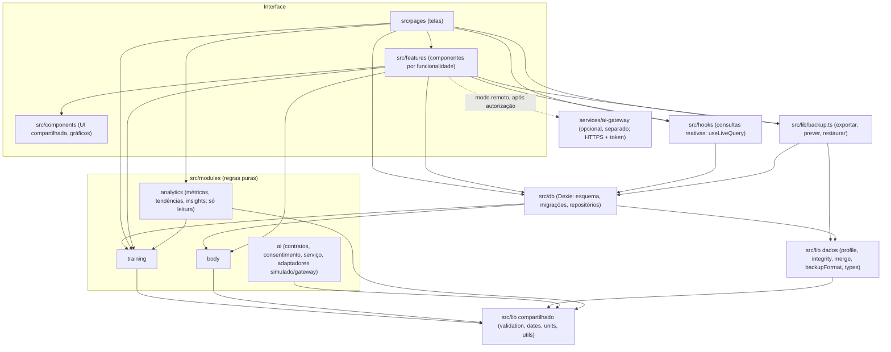

# Arquitetura

IronTrack 2.0 · Fase 01 · Prompt 03 (atualizado nos Prompts 04–07 com o módulo de IA e o gateway, no Prompt 08 com o motor de análise de treinos e no Prompt 09 com a análise avançada de exercícios). Descreve a organização do
código depois da modularização incremental, as dependências permitidas e as que os testes bloqueiam. O
módulo de IA tem documento próprio: [IA_ARQUITETURA.md](IA_ARQUITETURA.md); o de análise de treinos, [ANALYTICS_TREINAMENTO.md](ANALYTICS_TREINAMENTO.md). As regras automáticas estão em
`tests/unit/architecture.test.ts`; a compatibilidade dos imports antigos, em `tests/unit/api-compat.test.ts`.

## 1. Visão geral

O IronTrack é um PWA offline-first, sem backend obrigatório (o gateway de IA opcional do P06 vive à parte,
em `services/ai-gateway`, e o app funciona sem ele): React 18 + TypeScript (estrito), Vite, Dexie
(IndexedDB), Zod, Recharts e vite-plugin-pwa, publicado no GitHub Pages. Todo dado mora no
navegador e pertence ao perfil local (ver [PERFIL_LOCAL.md](PERFIL_LOCAL.md)).

A arquitetura é **híbrida e em camadas**: os domínios têm regras puras em `src/modules/`, a
persistência fica centralizada em `src/db/`, as consultas reativas em `src/hooks/` e a interface
continua em `src/pages/`, `src/features/` e `src/components/`. Não há camada hexagonal completa nem
interfaces abstratas para provedores que ainda não existem.



`training` e `body` não se conhecem. `analytics` (P08) é um modelo de leitura sobre o treinamento: usa só a
API pública de `training` e é usado só pela tela de desempenho; ninguém do domínio, da IA ou do banco o importa. Nenhum domínio importa React, Dexie, `src/db`, hooks ou telas. O módulo
`ai` não importa `training` nem `body`; desde o Prompt 05 ele é usado só pela funcionalidade de assistente
(`src/integrations/ai`, `src/features/assistant` e `src/pages/AIAssistantPage.tsx`).

## 2. Estrutura atual

```
src/
  App.tsx, main.tsx        rotas (HashRouter, páginas sob demanda) e abertura do banco
  modules/
    training/              domínio de treinamento (puro)
      index.ts             API pública: importe sempre '@/modules/training'
      types.ts             Routine, Workout, ExerciseTemplate, WorkoutSession, SessionSet,
                           RestState, RotationState, DayOverride, ProgressionPrefs, RestDefaults…
      routineSchema.ts     ficha JSON (irontrack.ficha v1/v2): validação, importação, exportação
      exerciseModel.ts     modalidades (P10): vocabulário, limites, validação e medidas por modalidade
      session.ts           montar, editar e concluir sessões; histórico; substituições
      rotation.ts          rotação ABC, políticas de avanço, agenda projetada
      progression.ts       motor de progressão dupla (determinístico)
      volume.ts, stats.ts  volume, séries válidas, 1RM estimado, recordes, estatísticas semanais
      restTimer.ts         cronômetro de descanso baseado em timestamps
      equipment.ts         rótulos de equipamento (pt-BR)
    body/                  domínio de evolução corporal (puro)
      index.ts             API pública: importe sempre '@/modules/body'
      types.ts             BodyEntry, ProgressPhoto
      bodySchema.ts        avaliações JSON (irontrack.avaliacoes v1)
      bodyPdf.ts           leitura do relatório antropométrico (pdf.js sob demanda) e interpretação
      bodyEvolution.ts     métricas, variações e veredito de evolução
      bodyRegions.ts       regiões do mapa corporal (antes × agora)
    ai/                    fundação de IA (puro, sem rede, sem persistência; ver IA_ARQUITETURA.md)
      index.ts             API pública: importe sempre '@/modules/ai' (não exporta adaptadores)
      domain/              types.ts, contracts.ts (AIProvider), permissions.ts (categorias, AIConsent), errors.ts
      application/         ProviderRegistry.ts, ContextBuilder.ts, AIService.ts
      adapters/            MockAIProvider.ts (simulado, offline; único adaptador)
    analytics/             motor de análise de treinos (P08; puro, só leitura; ver ANALYTICS_TREINAMENTO.md)
      index.ts             API pública: importe sempre '@/modules/analytics'
      domain/              types.ts, periods.ts (calendário), metrics.ts (métricas, recordes), trends.ts,
                           muscles.ts (normalização de grupos, P09), classification.ts (tipo do exercício, P09),
                           oneRepMax.ts (1RM canônico + adaptador do gráfico antigo, P09),
                           modalities.ts (tempo, cardio, lados, peso corporal: cálculos puros, P09)
      application/         TrainingAnalyticsService.ts, InsightsEngine.ts, summary.ts (resumo p/ IA, não usado),
                           indicators.ts (explicações dos indicadores e análises disponíveis, P09)
  lib/                     compartilhado e infraestrutura crítica de dados
    validation.ts          ParseResult, parseJsonText, formatZodError (genéricos)
    dates.ts, units.ts     datas locais yyyy-mm-dd; conversão kg ↔ lb
    utils.ts               uid, formatação numérica, cn, download/leitura de arquivo
    defaults.ts            configurações padrão
    types.ts               Settings, DataSnapshot, OWNED_COLLECTIONS + reexporta os tipos dos domínios
    profile.ts             LocalProfile e regras puras do perfil local
    integrity.ts           verificação de integridade referencial (pura)
    merge.ts               plano de mesclagem de backup (puro)
    backupFormat.ts        contrato do backup JSON v0/v1/v2/v3 (puro)
    backup.ts              operações de backup no banco (transações); reexporta backupFormat
    alerts.ts, install.ts  APIs do navegador (som, vibração, notificação, instalação do PWA)
    session.ts, rotation.ts, … (11 arquivos)  reexportações @deprecated dos módulos (compatibilidade)
  integrations/
    ai/                    raiz de composição do assistente (P05/P06; ver IA_ARQUITETURA.md, seções 17 e 18)
      assistantService.ts  ÚNICO ponto que registra adaptadores (simulado; remotos ao conectar o gateway)
      gatewayTransport.ts  ÚNICO fetch de IA do app: rotas fixas do gateway, sem redirect/cookies (P06)
      contextSources.ts    leitura mínima (só leitura) das categorias escolhidas + observação de mudanças
  db/
    db.ts                  esquema Dexie v2, migração v1 → v2, perfil, hooks de dono, configurações,
                           dataTables(), clearLocalData()
    repo.ts                persistência de treinamento (rotinas, rotação, sessões; leituras recentes p/ o assistente)
    body.ts                persistência de evolução corporal (avaliações, fotos, importação do PDF; leituras)
    profiles.ts            acesso ao perfil local
  hooks/
    data.ts                configurações, perfil, rotinas, sessões, rotação e agenda (useLiveQuery)
    useBody.ts             avaliações e fotos
    useUnits.ts            exibição de pesos na unidade escolhida
  features/                workout/, routines/, body/, backup/, assistant/ (conversa, prévia, modo remoto, useAssistant)
  components/              ui/ (botões, diálogos…), charts.tsx, AppLayout, SortableList…
  pages/                   Início, Treinos, Editor, Treino ativo, Histórico, Detalhe, Progresso, Desempenho
                           (P08, #/evolucao/desempenho), Assistente IA, Configurações
services/
  ai-gateway/              gateway de IA opcional (P06): node:http, sem dependências, bloqueado por padrão
                           (src/, providers/, tests/, config/*.example.json; ver IA_GATEWAY.md)
                           P07: credenciais com keyId/expiração/revogação e recarregamento sem reinício,
                           métricas sem dados pessoais, scripts/token.ts (rotação atômica) e
                           scripts/homologate.ts (homologação manual travada); ver IA_HOMOLOGACAO.md
```

## 3. Responsabilidades dos domínios

| Domínio | Regras puras (`src/modules`) | Persistência (`src/db`) | Interface |
| --- | --- | --- | --- |
| Treinamento | fichas, sessões, rotação ABC, progressão, volume, 1RM, estatísticas, descanso | `repo.ts`: rotinas, rotação, sessões (iniciar, salvar, concluir e avançar a rotação numa transação) | `pages/*` (exceto corpo), `features/workout`, `features/routines` |
| Evolução corporal | avaliações JSON, PDF, métricas, regiões do mapa | `body.ts`: avaliações com fotos (atômico), exclusão em cascata, importação do PDF só de meses novos (transação) | `features/body`, aba Corpo em `ProgressPage` |
| Análise de treinos (P08) | `modules/analytics`: frequência, volume, séries, cargas, recordes, tendências, insights | nenhuma (lê `useCompletedSessions`; não grava) | `pages/TrainingAnalyticsPage.tsx` (sub-rota de Evolução) |
| Identidade local | `lib/profile.ts` | `db/db.ts` (criação, reparo, hooks de dono), `db/profiles.ts` | Configurações › Perfil local |
| Backup e integridade | `lib/backupFormat.ts`, `lib/integrity.ts`, `lib/merge.ts` | `lib/backup.ts` | `features/backup`, Configurações › Dados e backup |

Integridade e mesclagem conhecem todas as coleções de propósito: verificam o retrato completo dos dados
(referências de sessões a rotinas, fotos a avaliações etc.). Por isso ficam fora dos domínios.

## 4. Fluxo de dados

Leitura: a tela chama um hook (`useCompletedSessions`, `useBodyEntries`…) → `useLiveQuery` consulta o
Dexie → a tela calcula o que exibe com funções puras dos domínios (`sessionVolume`, `metricChanges`…).
O Dexie avisa o hook a cada mudança e a tela se redesenha.

Escrita: a tela chama uma operação de `src/db` (ou `lib/backup.ts`), que lê o necessário, aplica a regra
pura e grava **na mesma transação**. Exemplos:

- concluir treino: `completeSession` → `finishSession` + `shouldAdvance` + `indexAfter` → grava sessão e rotação;
- iniciar treino: `startSession` → `buildSession` (com o histórico) → grava a sessão ativa;
- importar PDF: `extractPdfItems` → `parseAnthropometricItems` (puros) → `importBodyEvaluations` (transação);
- restaurar backup: `parseBackup` (puro) → `previewRestore` → `restoreBackupMerge`/`restoreBackupReplace`.

A sessão em andamento é gravada a cada ação (`saveSession`) e recuperada ao reabrir o app.

## 5. Persistência

- Banco `irontrack`, Dexie **v2** (inalterado nesta etapa): tabelas `settings`, `profiles`, `routines`,
  `sessions`, `rotations`, `overrides`, `bodyEntries`, `photos`. Histórico em [MIGRACOES.md](MIGRACOES.md).
- A instância `db` e o esquema ficam só em `src/db/db.ts`. As telas não a importam (regra testada).
- Repositórios por domínio, com funções explícitas (`completeSession`, `importBodyEvaluations`). Não há
  repositório genérico: cada operação mantém sua regra de negócio e sua transação.
- `dataTables()` é a lista única das tabelas de dados, usada pelo backup e por "apagar tudo".
- Hooks Dexie de criação/atualização garantem o `profileId` (ver [PERFIL_LOCAL.md](PERFIL_LOCAL.md)).

## 6. Contratos e validações

| Contrato | Arquivo | Versões |
| --- | --- | --- |
| Ficha de treino `irontrack.ficha` | `modules/training/routineSchema.ts` | 1, 2 ([FICHA_JSON.md](FICHA_JSON.md)) |
| Avaliações `irontrack.avaliacoes` | `modules/body/bodySchema.ts` | 1 |
| Backup `irontrack` / `backup` | `lib/backupFormat.ts` | 0, 1, 2, 3 ([BACKUP_RESTAURACAO.md](BACKUP_RESTAURACAO.md)) |
| Registros persistidos | `modules/*/types.ts`, `lib/types.ts`, `lib/profile.ts` | Dexie v2 (campos de modalidade do P10 dentro dos registros) |

Os três formatos usam `lib/validation.ts` (`parseJsonText`, `formatZodError`). Cada formato informa seus
rótulos de caminho: a ficha usa "Treino N › Exercício N"; avaliações reescrevem "Avaliação N"; o backup
mostra o caminho técnico. As mensagens são as mesmas de antes (caracterizadas em
`tests/unit/characterization.test.ts`).

Convenções de unidade: pesos sempre em **kg** no banco e nos arquivos (carga total externa); lb só na
exibição (`lib/units.ts`, arredondamento de 0,01 na exibição e 0,001 na gravação). Circunferências em cm,
dobras em mm, gordura em %, datas de avaliação e de agenda como `yyyy-mm-dd` local, instantes como
timestamp em ms. Descansos e durações em segundos; distâncias em **metros** (m, km ou milhas só na exibição e
digitação, conforme `distanceUnit` do exercício).

## 7. Dependências permitidas

- `pages`, `features`, `components` → `hooks`, funções de `src/db` (exceto a instância `db`), `lib`,
  API pública dos domínios (`@/modules/training`, `@/modules/body`).
- `hooks` → `src/db`, `lib`, domínios.
- `src/db` e `lib/backup.ts` → domínios, `lib`.
- `modules/<domínio>` → arquivos do próprio domínio, `lib/utils`, `lib/dates`, `lib/validation`, `zod`
  (e `pdfjs-dist`, carregado sob demanda, em `body`).
- `lib/types.ts` → `modules/*/types.ts` (agregador de tipos, só tipos).
- `modules/ai/domain` → só o próprio `domain`; `modules/ai/application` → `domain`, `application` e
  `lib/dates`; `modules/ai/adapters` → só `domain` (contratos).
- `integrations/ai` → `@/modules/ai`, funções de **leitura** de `src/db`, `lib`, domínios, `dexie`
  (`liveQuery`); só `integrations/ai/assistantService.ts` importa adaptadores (`MockAIProvider`,
  `GatewayAIProvider`; lista `ADAPTER_IMPORTS` no teste). `integrations/ai/gatewayTransport.ts` é o único
  arquivo do assistente com rede e só é usado pela raiz de composição.
- `services/ai-gateway` não importa `src/` e `src/` não importa `services/` (implantações independentes).
- `modules/analytics` → o próprio módulo, `lib/dates` e **só** `modules/training/index.ts` (exceção documentada à
  regra de domínios); telas → `@/modules/analytics`.
- `features/assistant` e `pages/AIAssistantPage.tsx` → `@/modules/ai`, `integrations/ai`, componentes e `lib`.

## 8. Dependências proibidas (testadas)

1. Qualquer dependência circular, inclusive só de tipos.
2. Domínio importando React, Dexie, `src/db`, `src/hooks`, telas, `lib/types` ou outro domínio.
3. `training` ↔ `body` em qualquer direção.
4. Arquivo interno de um domínio importado de fora dele (só `index.ts` é público).
5. Telas e componentes importando `dexie`, `dexie-react-hooks` ou a instância `db`.
6. `src/lib` importando React, hooks ou telas; `src/lib` importando domínios (exceto `types.ts`, as
   reexportações e `lib/integrity.ts` → `modules/training/index.ts`, exceção documentada no P10 para validar os
   campos de modalidade com as mesmas regras do domínio, sem duplicá-las); regras puras (`validation`, `integrity`, `merge`, `profile`, `backupFormat`, `dates`,
   `units`, `defaults`, `types`, `utils`) importando o banco.
7. `src/db` importando React, `sonner`, hooks ou telas.
8. Código novo usando os caminhos `@deprecated` de `src/lib` (`session`, `rotation`, `progression`,
   `volume`, `stats`, `restTimer`, `routineSchema`, `bodySchema`, `bodyPdf`, `bodyEvolution`, `bodyRegions`).
9. Módulo de IA (bloco "arquitetura do módulo de IA"): domínio de IA importando qualquer coisa fora de
   `domain/` (React, Dexie…); aplicação importando adaptadores, banco ou interface; adaptadores importando
   algo além dos contratos ou tocando `src/db`, hooks, `src/lib` ou Dexie; `training`/`body` importando o
   módulo de IA; qualquer arquivo fora do módulo importando adaptadores ou internals (exceto a raiz de
   composição `integrations/ai/assistantService.ts`); hooks, banco, `src/lib` e as outras telas usando o
   módulo (só o assistente pode); IndexedDB, storage, cookies, Cache Storage, `fetch`, XHR,
   WebSocket, EventSource ou beacon no módulo; URLs, `import.meta.env`, `VITE_`, `process.env` ou padrões
   de chave no módulo; SDKs de provedores de IA no `package.json`; segredos `VITE_*` em arquivos `.env`.

10. Assistente (bloco "arquitetura do assistente de IA", P05): tela do assistente importando `src/db`,
    `dexie` ou adaptadores; a integração importando da persistência algo além das funções de leitura
    (`getSettings`, `completedSessionsSince`, `recentCompletedSessions`, `listBodyEntries`,
    `recentBodyEntries`) ou chamando métodos de escrita do Dexie; `dangerouslySetInnerHTML`, `innerHTML`,
    `eval`, `new Function`, `localStorage`, `sessionStorage`, `indexedDB`, `fetch`, XHR, WebSocket, beacon,
    cookies, Cache Storage ou `console.*` no assistente; URLs, variáveis de ambiente ou chaves; rota do
    assistente que não seja carregada sob demanda ou que substitua outra.

11. Analytics (bloco "arquitetura do motor de analytics", P08): domínio ou aplicação importando algo além do
    próprio módulo, `lib/dates` e da API pública do treinamento; qualquer dependência de IA, corpo, banco,
    hooks, integrações, interface ou pacotes; escrita, armazenamento, rede, URLs ou variáveis de ambiente;
    IA, assistente, treinamento, corpo, banco, hooks ou `lib` importando analytics; import de internals;
    página que não seja carregada sob demanda em `/evolucao/desempenho` ou que mude a navegação de 6 itens.

## 9. Pontos de extensão futuros

Nada disto existe ainda; estes são os lugares previstos, sem interfaces antecipadas:

- **Novo domínio** (ex.: nutrição): `src/modules/nutrition/` com `types.ts`, regras puras e `index.ts`;
  persistência em `src/db/nutrition.ts`; nova tabela só com uma nova versão do Dexie e migração
  (ver [MIGRACOES.md](MIGRACOES.md)) e nova versão do backup se entrar no arquivo.
- **IA multiprovedor**: a fundação existe em `src/modules/ai` (Prompt 04), a interface do assistente desde o
  Prompt 05 e o modo remoto via gateway seguro desde o Prompt 06 ([IA_GATEWAY.md](IA_GATEWAY.md)), endurecido
  no Prompt 07 ([IA_HOMOLOGACAO.md](IA_HOMOLOGACAO.md); o gateway roda como **uma única instância**). Adaptadores reais entram em `src/modules/ai/adapters/`, registrados
  pela raiz de composição `src/integrations/ai/assistantService.ts`; a tela
  entrega ao `AIService` resumos calculados com funções puras dos domínios (ex.: `metricChanges`) e nunca
  dados lidos pelo módulo de IA no Dexie. Provedores remotos com chave privada dependem de uma estratégia de
  execução segura (ver [IA_ARQUITETURA.md](IA_ARQUITETURA.md), seção 10).
- **Recomendações de treino**: partem de `suggestProgression` e das estatísticas, que já são puras e
  determinísticas.
- **Sincronização**: `lib/backupFormat.ts` e `lib/merge.ts` já validam e mesclam retratos sem banco;
  `snapshotFingerprint` detecta mudanças.

## 10. Decisões e trade-offs

- **Híbrido em vez de mover tudo.** Só as regras puras foram para `src/modules`. Telas, componentes e o
  banco ficaram onde estavam: mover não traria benefício e aumentaria o risco. Os 11 caminhos antigos de
  `src/lib` viraram reexportações `@deprecated` para não quebrar imports existentes (inclusive dos testes).
- **Sem subpastas domain/application/infrastructure.** Cada domínio tem só regras puras; a coordenação
  (aplicação) acontece nos repositórios de `src/db` e em `features/routines/importFicha.ts`. Uma camada de
  serviço que só repassasse chamadas seria abstração prematura.
- **Persistência centralizada em `src/db`**, separada por domínio, em vez de um repositório por módulo
  dentro de `src/modules`: mantém o Dexie, o esquema e as transações num só lugar.
- **Regras de treino recebem só os campos que usam** (`RestDefaults`, `ProgressionPrefs`) em vez de
  `Settings`, que é do app: evita ciclo entre os tipos do domínio e os do app.
- **Backup dividido em contrato puro e operações**: o formato pode ser validado sem abrir o banco; o
  caminho `@/lib/backup` continua exportando tudo.
- **Testes de arquitetura com expressão regular** em vez de uma ferramenta nova (dependency-cruiser,
  ESLint boundaries): zero dependências, roda com o Vitest. Limitação: não entende imports gerados
  dinamicamente com strings calculadas (não há nenhum no projeto).

## 11. Refatorações identificadas e adiadas

| Item | Evidência | Por que foi adiado |
| --- | --- | --- |
| Dois cálculos de 1RM | `stats.ts` (`exerciseSeries`) usa Epley inline e, com 1 repetição, dá carga × 1,033; `volume.ts` (`estimate1RM`, usado nos recordes) devolve a própria carga | Unificar muda valores do gráfico de progresso. Divergência fixada em teste de caracterização. P08: o motor de analytics adotou `estimate1RM` (até 12 repetições) sem alterar o gráfico antigo. P09: contrato canônico `epley-1a12-v1` em `modules/analytics/domain/oneRepMax.ts` e adaptador `legacyChartE1rm` que reproduz o gráfico antigo; proposta de migração da apresentação em ANALYTICS_TREINAMENTO.md, seção 4, aguardando autorização. |
| `Settings` mistura app e treino | `lib/types.ts`: tema, unidade e nome junto de descanso, progressão, rotação e grupos musculares | Separar mudaria o registro persistido `settings` e o backup. |
| Componentes grandes | `WorkoutsPage.tsx` (525 linhas), `BodySection.tsx` (504), `ActiveWorkoutPage.tsx` (493), `SettingsPage.tsx` (479) | A lógica de negócio que tinham já saiu; o restante é apresentação. Dividir em subcomponentes é risco visual sem ganho funcional agora. |
| Cálculos de exibição no `BodySection` | séries dos gráficos e tabela montadas no componente | São apresentação (unidades, filtros); mover para o domínio só quando outro consumidor precisar. |
| `lib/utils.ts` misto | `cn` (Tailwind) junto de `uid`, formatação e leitura de arquivo | Não causa acoplamento real hoje; dividir é estético. |
| Serviço de ficha com `toast` | `features/routines/importFicha.ts` (`loadSampleFicha`) mostra notificações | Fica na camada de interface (features); mover exigiria mudar dois chamadores. |
| Instância global `db` + `setDb` | `db/db.ts` | Injeção de dependência nos repositórios só compensa com um segundo armazenamento (ex.: sincronização). |
| Fotos como data URL no IndexedDB | `ProgressPhoto.dataUrl` | Mudar o armazenamento exige migração e nova versão do backup. |
| Remover os caminhos `@deprecated` | 11 arquivos em `src/lib` | Remover depois que os testes antigos migrarem para `@/modules/*`; o teste de arquitetura já impede usos novos. |

## 12. Modelo de exercícios (P09 → P10)

> **P10:** o modelo foi implementado. Vocabulário, limites e validação em `modules/training/exerciseModel.ts`
> (puro, exportado pelo `index.ts`); campos opcionais em `ExerciseTemplate`, `SessionExercise` e `SessionSet`;
> integridade com `INVALID_MODALITY_FIELD` (erro) e `MODALITY_CONTRADICTION` (aviso); backup v3; ficha versão 2.
> O Dexie **continua na v2** (campos dentro dos registros, sem índice). Detalhes em
> [MIGRACAO_EXERCICIOS_V3.md](MIGRACAO_EXERCICIOS_V3.md). O parágrafo abaixo descreve a situação do P09.

O banco continua na **v2** e o editor de treinos não grava campos novos. A análise avançada (P09) trabalha só
com o que já existe por exercício (`muscleGroup`, `equipment`, `category`) e por série (`weight`, `reps`,
`type`, `status`, `rpe`, `rir`). Duração, distância, lado corporal, assistência e modalidade explícita **não
existem**: os cálculos correspondentes estão em `modules/analytics/domain/modalities.ts` como funções puras
testadas com dados fictícios, e a tela mostra "Este exercício ainda não possui dados suficientes para esse tipo
de análise.". A proposta de evolução do modelo está em [MODELO_EXERCICIOS_V2.md](MODELO_EXERCICIOS_V2.md).

A conversão kg ↔ lb do contrato de 1RM usa a constante exata `KG_PER_LB` declarada no próprio módulo (igual a
`lib/units`, verificado em teste) para manter as regras de dependência do domínio sem exceção nova.


## 13. Cronômetros e concorrência (P11)

Detalhes em [CRONOMETROS_E_CONCORRENCIA.md](CRONOMETROS_E_CONCORRENCIA.md).

| Camada | Arquivo | Responsabilidade |
| --- | --- | --- |
| Domínio (puro) | `modules/training/setTimer.ts` | estado e transições do cronômetro de execução, recuperação, relógio |
| Domínio (puro) | `modules/training/sessionMerge.ts` | mescla em três vias do treino em andamento |
| Domínio (puro) | `modules/training/modelCompat.ts` | fotografia/detecção/restauração dos campos de modalidade, capacidade |
| Persistência | `db/repo.ts` | `saveSessionGuarded` (transação + mescla), `completeSession` idempotente, restauração |
| Persistência | `db/modelGuard.ts` | estado auxiliar em `localStorage` e ganchos do Dexie na tabela de rotinas |
| Funcionalidade | `features/workout/setTimerStore.ts`, `SetTimerWatcher.tsx`, `SetTimerPanel.tsx` | cronômetro compartilhado entre telas e abas |
| Funcionalidade | `features/compat/CompatGuard.tsx` | avisos de compatibilidade |

- **Estado transitório fora do banco.** O cronômetro, a fotografia e a capacidade ficam em `localStorage`: não entram
  no IndexedDB, não mudam o esquema (Dexie v2) e não entram em backups. É uma decisão consciente: perder esse estado
  nunca altera dados de treino.
- **Gravação do treino ativo.** A tela mantém a última versão conhecida do banco e grava por uma fila; cada gravação
  compara com o banco na mesma transação e mescla em vez de sobrescrever. `saveSession` (gravação direta) continua
  disponível para compatibilidade e testes antigos.
- **Regras de dependência** inalteradas: os três arquivos novos do domínio são puros e importados só pela API pública
  (`@/modules/training`); as telas não acessam o Dexie diretamente (`tests/unit/architecture.test.ts` continua
  passando).
