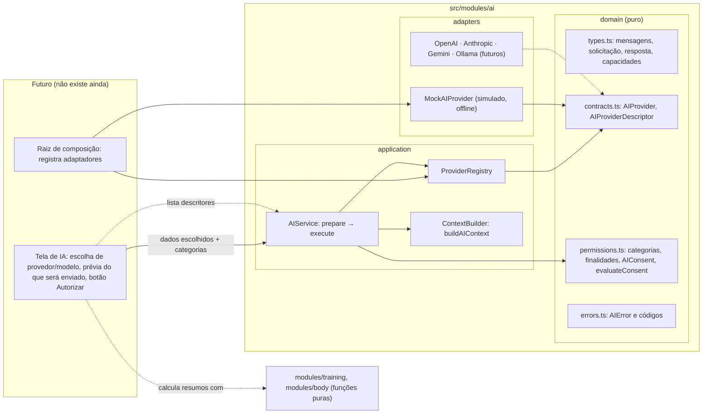

# Arquitetura de IA

IronTrack 2.0 · Fase 01 · Prompt 04. Fundação técnica para usar provedores de inteligência artificial
no futuro, com privacidade por padrão. **Nesta etapa não existe assistente de IA para o usuário**: não há
chat, botão, configuração de chave nem chamada real a provedor. O app continua 100% offline e funciona
igual sem nenhuma IA configurada.

Código: `src/modules/ai`. Testes: `tests/unit/ai-*.test.ts` e o bloco "arquitetura do módulo de IA" de
`tests/unit/architecture.test.ts`. Regras gerais de camadas: [ARQUITETURA.md](ARQUITETURA.md).

## 1. Visão geral

O módulo define **contratos** (o que um provedor precisa oferecer), um **registro** de provedores com
seleção explícita, um **construtor de contexto** que só usa dados entregues e categorias autorizadas, uma
**política de consentimento por solicitação** e um **serviço central** que coordena tudo. O único
adaptador existente é o **simulado** (`MockAIProvider`), que roda sem rede e serve aos testes.

Princípios:

- nenhum dado pessoal sai do aparelho sem autorização explícita para aquela solicitação exata;
- na dúvida, negar (categoria, finalidade ou autorização desconhecida = recusa);
- seleção explícita de provedor e modelo, sem padrão e sem troca automática quando um falha;
- a IA só lê o que recebe e só devolve texto: não executa ações e não altera registros;
- nada de IA é persistido (nem no IndexedDB, nem no localStorage, nem no backup).

## 2. Diagrama de componentes



Setas tracejadas são dependências previstas. `training` e `body` **não** conhecem o módulo de IA: quem
chamar a IA no futuro calcula os resumos com as funções puras desses domínios e entrega o resultado.

## 3. Contratos TypeScript

Arquivo `domain/contracts.ts` e `domain/types.ts`. Resumo:

```ts
interface AIProvider {
  readonly id: string;                      // "mock", "openai"… único no registro
  readonly displayName: string;
  readonly kind: 'remote' | 'local' | 'simulated';
  readonly models: readonly AIModelInfo[];  // capacidades POR MODELO
  isAvailable?(): boolean | Promise<boolean>;
  generate(request: AIRequest, options?: { signal?: AbortSignal }): Promise<AIProviderResult>;
}

interface AICapabilities {
  textGeneration: boolean; systemMessages: boolean; structuredOutput: boolean;
  imageInput: boolean; streaming: boolean; maxInputChars: number; maxOutputTokens: number;
}

interface AIRequest {                       // o que o adaptador recebe, já validado
  modelId: string;
  messages: readonly { role: 'system' | 'user' | 'assistant'; content: string }[];
  maxOutputTokens: number;
  responseFormat: { type: 'text' } | { type: 'json'; schemaName: string };
}

interface AIProviderResult {                // o que o adaptador devolve (conferido em tempo de execução)
  modelId: string;
  output: { type: 'text'; text: string } | { type: 'json'; text: string; value: JsonValue };
  finishReason: 'stop' | 'length';
  usage?: { inputTokens?: number; outputTokens?: number };
}

interface AIResponse {                      // o que quem chamou recebe, congelado
  providerId; modelId; output; finishReason; usage?;
  metadata: { requestId; startedAt; finishedAt; durationMs; simulated; truncated };
}
```

Extensibilidade: `responseFormat: json` e `AIOutput` do tipo `json` já existem no contrato, mas só valem
para modelos que declaram `structuredOutput`. `imageInput` e `streaming` estão declarados e não são usados.
Não há `any` no módulo.

## 4. Registro de provedores

`ProviderRegistry` (em memória, sem persistência):

| Operação | Comportamento |
| --- | --- |
| `register(p)` | Valida ID (`^[a-z0-9][a-z0-9-]{1,39}$`), nome, tipo, `generate`, modelos (não vazios, IDs únicos, capacidades completas). Inválido → `provider_invalid`; repetido → `provider_duplicate` (o existente fica). |
| `list()` | Descritores copiados (ID, nome, tipo, modelos e capacidades), sem o adaptador. É o que a interface pode ver. |
| `resolve(provider, modelo, capacidades)` | `provider_not_found`, `model_unsupported` ou `capability_unsupported`. |

Não existe provedor padrão nem fallback: o serviço exige `providerId` e `modelId` em cada solicitação e,
se o escolhido falhar, devolve o erro, sem tentar outro e sem repetir.

## 5. Fluxo de uma solicitação

```mermaid
sequenceDiagram
  participant T as Tela (futura)
  participant S as AIService
  participant C as ContextBuilder
  participant R as ProviderRegistry
  participant P as Adaptador
  T->>S: prepare({providerId, modelId, purpose, instruction, categories, sources})
  S->>R: resolve(provedor, modelo, capacidades)
  S->>C: buildAIContext(sources, categories)
  S-->>T: PreparedAIRequest (mensagens exatas, categorias, SHA-256)
  Note over T: mostra destino, finalidade e dados; usuário autoriza
  T->>S: execute(prepared, createConsent(prepared), {signal, timeoutMs})
  S->>S: recalcula o SHA-256, avalia a autorização, consome-a (uso único)
  S->>R: resolve de novo + isAvailable()
  S->>P: generate(request, {signal})
  P-->>S: AIProviderResult
  S-->>T: AIResponse normalizada (ou AIError)
```

1. **prepare** valida finalidade, formato, provedor, modelo e capacidades; limita a instrução (2.000
   caracteres), a instrução de sistema extra (2.000) e a saída (inteiro, ≤ 4.096 e ≤ limite do modelo,
   padrão 512); monta o contexto; gera as mensagens (instrução fixa de sistema + pedido + contexto JSON) e
   confere o limite de entrada do modelo. Modelo sem `systemMessages` recebe tudo numa mensagem de usuário.
   O resultado é congelado e assinado (SHA-256 do destino, finalidade, categorias, mensagens e limites).
2. **execute** recusa se o sinal já foi cancelado; recalcula a assinatura (qualquer alteração → negado);
   avalia a autorização; marca-a como usada; confere o provedor de novo e a disponibilidade; executa com
   cancelamento e tempo limite (padrão 60 s) mesmo que o adaptador ignore o sinal; normaliza a resposta.
3. **normalização**: `modelId` igual ao pedido, `finishReason` válido, tipo de saída igual ao pedido,
   texto string. Texto acima do limite (`maxOutputTokens × 4` caracteres) é cortado e marcado
   (`finishReason: 'length'`, `truncated: true`). JSON precisa ser válido e igual ao `value`; JSON acima do
   limite é `invalid_response` (cortar quebraria o JSON).

## 6. Controle de contexto

Categorias (`domain/permissions.ts`):

| Categoria | Fonte entregue por quem chama | O que entra |
| --- | --- | --- |
| `training_summary` | números já calculados (sessões, séries, volume, consistência, grupos) | os números, arredondados |
| `training_history` | sessões (`WorkoutSession` serve) | só concluídas, até 12 mais recentes: data (yyyy-mm-dd), rótulo/nome do treino, duração em min, exercícios (nome, grupo) e séries feitas (tipo, kg, reps, RPE, RIR) |
| `body_measurements` | avaliações (`BodyEntry` serve) | até 12 mais recentes: data e 13 medidas numéricas fixas |
| `body_evolution` | variações (`MetricChange` serve) | nome da medida, unidade, primeira, última, variação, veredito |
| `profile_preferences` | preferências (`Settings` serve) | unidade de peso, dias de treino por semana, objetivo |
| `progress_photos` | — | **bloqueada**: nunca entra |

`buildAIContext(sources, categories, limites)`:

1. só usa `sources` recebidas; não abre o IndexedDB nem chama `src/db` (testado);
2. categoria desconhecida → `context_invalid`; repetidas são unificadas;
3. copia campo a campo de listas fechadas: IDs (`id`, `routineId`, `profileId`…), nome do usuário,
   observações livres, dobras avulsas, timestamps e fotos não têm caminho de entrada;
4. textos curtos (60 caracteres), sem data URL (descartados) e com UUIDs mascarados como `[id]`;
5. limite total de 12.000 caracteres: descarta primeiro o histórico mais antigo, depois as avaliações mais
   antigas; se ainda não couber, `context_invalid`;
6. devolve `included`, `excluded` (com motivo `not_selected`, `blocked` ou `no_data`) e `truncated`, para a
   prévia mostrar ao usuário exatamente o que vai e o que ficou de fora.

## 7. Política de consentimento

`AIConsent` (só em memória):

```ts
{ id, providerId, modelId, purpose, categories, scope: { requestId, binding }, grantedAt, expiresAt }
```

`evaluateConsent(consent, alvo, agora)` nega, nesta ordem, quando: ausente; malformado (inclui finalidade
desconhecida); categoria desconhecida; categoria bloqueada (fotos); provedor diferente; modelo diferente;
finalidade diferente; conjunto de categorias diferente (nem a mais, nem a menos); `requestId` ou assinatura
diferentes; antes de `grantedAt`; expirado (padrão 5 min, máximo 15 min). O serviço ainda nega uma
autorização já usada: **cada autorização vale para uma única execução**.

Consequências testadas: sem autorização não há execução; autorizar treino não libera avaliações; autorizar
avaliações não libera fotos; autorizar um provedor não vale para outro; mudar destino, modelo, finalidade,
categorias, mensagens ou limite invalida; preparar de novo o mesmo pedido gera outro `requestId`.

`createConsent(prepared, { grantedAt, id })` só deve ser chamado pela interface **depois** que o usuário viu
a prévia e confirmou. O consentimento é um contrato de código: o que garante que ele reflete a vontade do
usuário é a tela futura mostrar a prévia antes do botão.

## 8. Política de privacidade

- Nada é enviado automaticamente; não há envio em segundo plano.
- Envia-se o mínimo: listas fechadas de campos, itens recentes, limites de tamanho.
- Identidade do perfil, IDs internos e observações livres nunca entram.
- Fotos ficam bloqueadas e não podem ser autorizadas nesta versão.
- Contexto, mensagens, autorizações e respostas existem só na memória da página; nada vai para IndexedDB,
  localStorage, sessionStorage, cookies, Cache Storage ou backup (regra de código e teste de execução).
- Logs (`logger` injetável) recebem só tipo do evento, `requestId`, provedor, modelo, código de erro e
  duração; nunca conteúdo.
- Mensagens de erro são frases fixas por código; a mensagem original de uma exceção do provedor é
  descartada (pode conter dados ou detalhes internos).
- A instrução fixa de sistema proíbe diagnóstico médico e prescrição nutricional e diz que a IA não executa
  ações.

## 9. Segurança das credenciais

Nesta etapa **não há armazenamento de chaves**. Não existem credenciais no código, em JSON, no backup, no
IndexedDB, no localStorage, nos logs ou nos testes, e nenhuma variável `VITE_*` com segredo. Os testes de
arquitetura bloqueiam no módulo de IA: URLs `http(s)://`, `import.meta.env`, `VITE_`, `process.env`,
padrões de chave (`sk-…`, `AIza…`, `Bearer`), além de SDKs de provedores no `package.json` e variáveis
`VITE_*KEY/TOKEN/SECRET` em arquivos `.env`.

## 10. Limitações de PWA estática

O IronTrack é servido como arquivos estáticos pelo GitHub Pages. Tudo o que o Vite incorpora ao bundle
(inclusive `VITE_*`) é público: qualquer pessoa lê no JavaScript baixado. Portanto:

- **não há cofre no navegador** para chaves privadas de provedores remotos;
- chave digitada pelo usuário e guardada no aparelho ficaria exposta a extensões, XSS e a quem acessar o
  aparelho, e iria junto em exportações se não fosse tratada à parte;
- chamar provedores remotos direto do navegador com chave privada embutida **não será feito**;
- um proxy aberto (sem autenticação e limite) também não: viraria um repasse gratuito para terceiros.

Provedores remotos que exigem credencial privada precisarão de uma **estratégia de execução segura** decidida
numa etapa própria, por exemplo: um backend autorizado (função serverless com autenticação do usuário,
limite de uso e chave guardada no servidor) ou um fluxo em que o próprio provedor emita credenciais de curta
duração com escopo restrito. Até lá, só o simulado existe.

## 11. Estratégia futura: OpenAI

- Adaptador `adapters/OpenAIProvider.ts` implementando `AIProvider`, `kind: 'remote'`.
- Configuração explícita de modelo e de **endpoint autorizado** (vindo do backend seguro, não fixo no código).
- Mapear `system/user/assistant` para o formato de mensagens da API; `maxOutputTokens` para o limite de saída
  do modelo; `responseFormat: json` só em modelos com saída estruturada.
- Capacidades declaradas por modelo (janela de entrada, saída máxima, JSON, imagem), sem presumir igualdade.
- Mapear erros HTTP: 401/403 → `provider_unavailable`; 404 de modelo → `model_unsupported`; 408/timeout →
  `timeout`; 429 e 5xx → `provider_failure` (sem repetir); corpo fora do contrato → `invalid_response`.
- Sem SDK no navegador; a chamada real passa pelo backend autorizado.

## 12. Estratégia futura: Anthropic

- Adaptador `adapters/AnthropicProvider.ts`, `kind: 'remote'`.
- Particularidades da API Claude: a instrução de sistema é um campo separado (não uma mensagem com papel
  `system`), as mensagens precisam alternar `user`/`assistant` começando por `user`, e o limite de saída é
  obrigatório em cada requisição. O adaptador converte `AIRequest` para esse formato.
- Conteúdo da resposta vem em blocos: o adaptador concatena os blocos de texto em `output.text` e mapeia o
  motivo de parada (fim normal → `stop`, limite de tokens → `length`).
- Credencial só no backend autorizado; nada de chave no navegador.

## 13. Estratégia futura: Google Gemini

- Adaptador `adapters/GeminiProvider.ts`, `kind: 'remote'`.
- Mapeamento de mensagens: papéis `user`/`model` (o `assistant` do contrato vira `model`) e instrução de
  sistema em campo próprio quando o modelo suporta; se não suportar, `systemMessages: false` e o serviço já
  junta tudo numa mensagem de usuário.
- Capacidades variam muito entre modelos (janela, JSON, multimodal): declarar uma a uma.
- Filtros de segurança do provedor podem bloquear a resposta: mapear para `invalid_response` com mensagem fixa.
- Credencial só no backend autorizado.

## 14. Estratégia futura: Ollama

- Adaptador `adapters/OllamaProvider.ts`, `kind: 'local'`, para um servidor **explicitamente configurado pelo
  usuário** (endereço digitado por ele; nenhum endereço padrão ativo no código).
- Cuidados antes de abrir qualquer conexão:
  - **origem e CORS**: o servidor local precisa permitir a origem do IronTrack; o app não deve pedir para
    liberar todas as origens;
  - **conteúdo misto**: o app é HTTPS; muitos navegadores bloqueiam chamadas a `http://` na rede local, e
    há restrições de acesso de páginas públicas à rede privada;
  - **rede local**: um endereço errado pode enviar dados a outro aparelho da rede; mostrar o endereço na
    prévia e exigir confirmação;
  - `isAvailable()` só verifica se o servidor responde, sem enviar dados do usuário;
  - modelos e capacidades lidos do servidor e validados pelo registro.
- Mesmo sendo local, cada envio continua exigindo autorização por solicitação.

## 15. Limites da implementação atual

- Não há interface de IA, chat, botões, seleção de modelo ou configuração de chaves.
- Nenhum adaptador real; nenhum SDK; nenhuma chamada de rede.
- Sem streaming, sem entrada de imagens, sem execução de ferramentas, sem agentes, sem repetição automática.
- Fotos bloqueadas em qualquer caso.
- O corte de saída usa a aproximação de 4 caracteres por token (não há tokenizador).
- O vínculo da autorização usa `crypto.subtle` (SHA-256); sem Web Crypto, o serviço recusa preparar.
- O registro e as autorizações usadas vivem na memória da página: recarregar zera tudo (proposital).
- Nenhum código do app importa o módulo de IA ainda; ele não entra no bundle de produção.

## 16. Orientações para adicionar provedores

1. Crie `src/modules/ai/adapters/<Provedor>Provider.ts` implementando `AIProvider`, importando só de
   `../domain/*` (regra testada).
2. Declare cada modelo com as próprias capacidades e limites.
3. Em `generate`: respeite `options.signal`, não repita requisições, não registre conteúdo em log, devolva
   `AIProviderResult` e lance `AIError` com o código adequado (o serviço transforma qualquer outro erro em
   `provider_failure`, sem a mensagem original).
4. Não acesse IndexedDB, storage, banco, hooks ou telas; o adaptador só recebe o `AIRequest`.
5. Credenciais e endpoints nunca no código: venha pela estratégia segura da seção 10.
6. Registre o adaptador numa raiz de composição (prevista em `src/integrations/ai/`), não nas telas; a
   interface usa só `AIService` e `listProviders()`. Hoje o teste de arquitetura proíbe qualquer import de
   `modules/ai/adapters` fora do módulo; ao criar essa raiz, abra uma exceção só para ela.
7. Escreva testes com o adaptador simulando as respostas da API (sem rede) e rode os testes de arquitetura.
