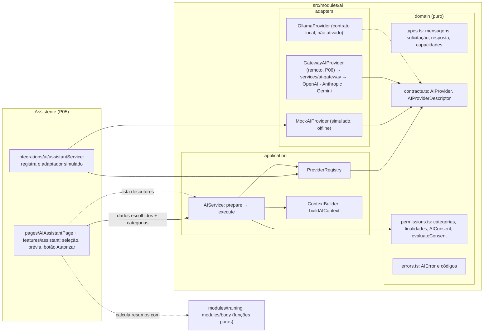
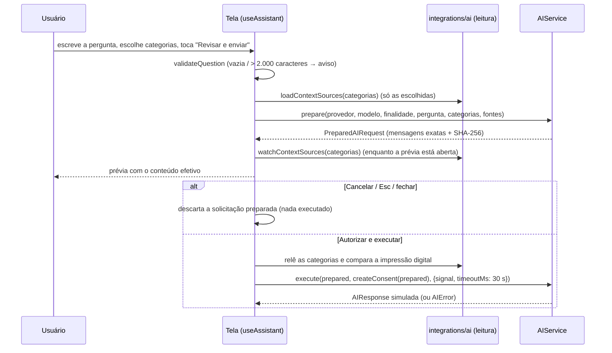

# Arquitetura de IA

IronTrack 2.0 · Fase 01 · Prompts 04, 05 e 06. Fundação técnica para usar provedores de inteligência artificial
com privacidade por padrão (P04), a primeira interface do assistente (P05) e a integração com provedores
reais **por meio de um gateway seguro** (P06). O modo **simulado continua o padrão** e funciona 100% offline;
o modo remoto só existe quando o usuário conecta um gateway e escolhe provedor e modelo. A interface está na
[seção 17](#17-interface-do-assistente-prompt-05) e o modo remoto na [seção 18](#18-modo-remoto-via-gateway-prompt-06).
O gateway em si (autenticação, limites, adaptadores OpenAI/Anthropic/Gemini) está em [IA_GATEWAY.md](IA_GATEWAY.md).

Código: `src/modules/ai`. Testes: `tests/unit/ai-*.test.ts` e o bloco "arquitetura do módulo de IA" de
`tests/unit/architecture.test.ts`. Regras gerais de camadas: [ARQUITETURA.md](ARQUITETURA.md).

## 1. Visão geral

O módulo define **contratos** (o que um provedor precisa oferecer), um **registro** de provedores com
seleção explícita, um **construtor de contexto** que só usa dados entregues e categorias autorizadas, uma
**política de consentimento por solicitação** e um **serviço central** que coordena tudo. O único
adaptador existente é o **simulado** (`MockAIProvider`), que roda sem rede e serve aos testes.

Princípios:

- nenhum dado pessoal sai do aparelho sem autorização explícita para aquela solicitação exata;
- na dúvida, negar (categoria, finalidade ou autorização desconhecida = recusa);
- seleção explícita de provedor e modelo, sem padrão e sem troca automática quando um falha;
- a IA só lê o que recebe e só devolve texto: não executa ações e não altera registros;
- nada de IA é persistido (nem no IndexedDB, nem no localStorage, nem no backup).

## 2. Diagrama de componentes



Setas tracejadas são dependências previstas. `training` e `body` **não** conhecem o módulo de IA: quem
chamar a IA no futuro calcula os resumos com as funções puras desses domínios e entrega o resultado.

## 3. Contratos TypeScript

Arquivo `domain/contracts.ts` e `domain/types.ts`. Resumo:

```ts
interface AIProvider {
  readonly id: string;                      // "mock", "openai"… único no registro
  readonly displayName: string;
  readonly kind: 'remote' | 'local' | 'simulated';
  readonly models: readonly AIModelInfo[];  // capacidades POR MODELO
  isAvailable?(): boolean | Promise<boolean>;
  generate(request: AIRequest, options?: { signal?: AbortSignal }): Promise<AIProviderResult>;
}

interface AICapabilities {
  textGeneration: boolean; systemMessages: boolean; structuredOutput: boolean;
  imageInput: boolean; streaming: boolean; maxInputChars: number; maxOutputTokens: number;
}

interface AIRequest {                       // o que o adaptador recebe, já validado
  modelId: string;
  messages: readonly { role: 'system' | 'user' | 'assistant'; content: string }[];
  maxOutputTokens: number;
  responseFormat: { type: 'text' } | { type: 'json'; schemaName: string };
}

interface AIProviderResult {                // o que o adaptador devolve (conferido em tempo de execução)
  modelId: string;
  output: { type: 'text'; text: string } | { type: 'json'; text: string; value: JsonValue };
  finishReason: 'stop' | 'length';
  usage?: { inputTokens?: number; outputTokens?: number };
}

interface AIResponse {                      // o que quem chamou recebe, congelado
  providerId; modelId; output; finishReason; usage?;
  metadata: { requestId; startedAt; finishedAt; durationMs; simulated; truncated };
}
```

Extensibilidade: `responseFormat: json` e `AIOutput` do tipo `json` já existem no contrato, mas só valem
para modelos que declaram `structuredOutput`. `imageInput` e `streaming` estão declarados e não são usados.
Não há `any` no módulo.

## 4. Registro de provedores

`ProviderRegistry` (em memória, sem persistência):

| Operação | Comportamento |
| --- | --- |
| `register(p)` | Valida ID (`^[a-z0-9][a-z0-9-]{1,39}$`), nome, tipo, `generate`, modelos (não vazios, IDs únicos, capacidades completas). Inválido → `provider_invalid`; repetido → `provider_duplicate` (o existente fica). |
| `list()` | Descritores copiados (ID, nome, tipo, modelos e capacidades), sem o adaptador. É o que a interface pode ver. |
| `resolve(provider, modelo, capacidades)` | `provider_not_found`, `model_unsupported` ou `capability_unsupported`. |

Não existe provedor padrão nem fallback: o serviço exige `providerId` e `modelId` em cada solicitação e,
se o escolhido falhar, devolve o erro, sem tentar outro e sem repetir.

## 5. Fluxo de uma solicitação

```mermaid
sequenceDiagram
  participant T as Tela (assistente)
  participant S as AIService
  participant C as ContextBuilder
  participant R as ProviderRegistry
  participant P as Adaptador
  T->>S: prepare({providerId, modelId, purpose, instruction, categories, sources})
  S->>R: resolve(provedor, modelo, capacidades)
  S->>C: buildAIContext(sources, categories)
  S-->>T: PreparedAIRequest (mensagens exatas, categorias, SHA-256)
  Note over T: mostra destino, finalidade e dados; usuário autoriza
  T->>S: execute(prepared, createConsent(prepared), {signal, timeoutMs})
  S->>S: recalcula o SHA-256, avalia a autorização, consome-a (uso único)
  S->>R: resolve de novo + isAvailable()
  S->>P: generate(request, {signal})
  P-->>S: AIProviderResult
  S-->>T: AIResponse normalizada (ou AIError)
```

1. **prepare** valida finalidade, formato, provedor, modelo e capacidades; limita a instrução (2.000
   caracteres), a instrução de sistema extra (2.000) e a saída (inteiro, ≤ 4.096 e ≤ limite do modelo,
   padrão 512); monta o contexto; gera as mensagens (instrução fixa de sistema + pedido + contexto JSON) e
   confere o limite de entrada do modelo. Modelo sem `systemMessages` recebe tudo numa mensagem de usuário.
   O resultado é congelado e assinado (SHA-256 do destino, finalidade, categorias, mensagens e limites).
2. **execute** recusa se o sinal já foi cancelado; recalcula a assinatura (qualquer alteração → negado);
   avalia a autorização; marca-a como usada; confere o provedor de novo e a disponibilidade; executa com
   cancelamento e tempo limite (padrão 60 s) mesmo que o adaptador ignore o sinal; normaliza a resposta.
3. **normalização**: `modelId` igual ao pedido, `finishReason` válido, tipo de saída igual ao pedido,
   texto string. Texto acima do limite (`maxOutputTokens × 4` caracteres) é cortado e marcado
   (`finishReason: 'length'`, `truncated: true`). JSON precisa ser válido e igual ao `value`; JSON acima do
   limite é `invalid_response` (cortar quebraria o JSON).

## 6. Controle de contexto

Categorias (`domain/permissions.ts`):

| Categoria | Fonte entregue por quem chama | O que entra |
| --- | --- | --- |
| `training_summary` | números já calculados (sessões, séries, volume, consistência, grupos) | os números, arredondados |
| `training_history` | sessões (`WorkoutSession` serve) | só concluídas, até 12 mais recentes: data (yyyy-mm-dd), rótulo/nome do treino, duração em min, exercícios (nome, grupo) e séries feitas (tipo, kg, reps, RPE, RIR) |
| `body_measurements` | avaliações (`BodyEntry` serve) | até 12 mais recentes: data e 13 medidas numéricas fixas |
| `body_evolution` | variações (`MetricChange` serve) | nome da medida, unidade, primeira, última, variação, veredito |
| `profile_preferences` | preferências (`Settings` serve) | unidade de peso, dias de treino por semana, objetivo |
| `training_goals` (P20) | metas já calculadas (`TrainingGoalSource`) | até 10: título, tipo, alvo, unidade, atual, progresso %, estado, prazo, exercício |
| `progress_photos` | — | **bloqueada**: nunca entra |

`buildAIContext(sources, categories, limites)`:

1. só usa `sources` recebidas; não abre o IndexedDB nem chama `src/db` (testado);
2. categoria desconhecida → `context_invalid`; repetidas são unificadas;
3. copia campo a campo de listas fechadas: IDs (`id`, `routineId`, `profileId`…), nome do usuário,
   observações livres, dobras avulsas, timestamps e fotos não têm caminho de entrada;
4. textos curtos (60 caracteres), sem data URL (descartados) e com UUIDs mascarados como `[id]`;
5. limite total de 12.000 caracteres: descarta primeiro o histórico mais antigo, depois as avaliações mais
   antigas; se ainda não couber, `context_invalid`;
6. devolve `included`, `excluded` (com motivo `not_selected`, `blocked` ou `no_data`) e `truncated`, para a
   prévia mostrar ao usuário exatamente o que vai e o que ficou de fora.

## 7. Política de consentimento

`AIConsent` (só em memória):

```ts
{ id, providerId, modelId, purpose, categories, scope: { requestId, binding }, grantedAt, expiresAt }
```

`evaluateConsent(consent, alvo, agora)` nega, nesta ordem, quando: ausente; malformado (inclui finalidade
desconhecida); categoria desconhecida; categoria bloqueada (fotos); provedor diferente; modelo diferente;
finalidade diferente; conjunto de categorias diferente (nem a mais, nem a menos); `requestId` ou assinatura
diferentes; antes de `grantedAt`; expirado (padrão 5 min, máximo 15 min). O serviço ainda nega uma
autorização já usada: **cada autorização vale para uma única execução**.

Consequências testadas: sem autorização não há execução; autorizar treino não libera avaliações; autorizar
avaliações não libera fotos; autorizar um provedor não vale para outro; mudar destino, modelo, finalidade,
categorias, mensagens ou limite invalida; preparar de novo o mesmo pedido gera outro `requestId`.

`createConsent(prepared, { grantedAt, id })` só deve ser chamado pela interface **depois** que o usuário viu
a prévia e confirmou. O consentimento é um contrato de código: o que garante que ele reflete a vontade do
usuário é a tela mostrar a prévia antes do botão (ver seção 17.3).

## 8. Política de privacidade

- Nada é enviado automaticamente; não há envio em segundo plano.
- Envia-se o mínimo: listas fechadas de campos, itens recentes, limites de tamanho.
- Identidade do perfil, IDs internos e observações livres nunca entram.
- Fotos ficam bloqueadas e não podem ser autorizadas nesta versão.
- Contexto, mensagens, autorizações e respostas existem só na memória da página; nada vai para IndexedDB,
  localStorage, sessionStorage, cookies, Cache Storage ou backup (regra de código e teste de execução).
- Logs (`logger` injetável) recebem só tipo do evento, `requestId`, provedor, modelo, código de erro e
  duração; nunca conteúdo.
- Mensagens de erro são frases fixas por código; a mensagem original de uma exceção do provedor é
  descartada (pode conter dados ou detalhes internos).
- A instrução fixa de sistema proíbe diagnóstico médico e prescrição nutricional e diz que a IA não executa
  ações.

## 9. Segurança das credenciais

> P06: as chaves dos provedores existem só no servidor do gateway ([IA_GATEWAY.md](IA_GATEWAY.md), seção 3).
> O app guarda apenas, **em memória**, o endereço do gateway e o token de acesso que o usuário digitou.

Até o P05 **não havia armazenamento de chaves**. Não existem credenciais no código, em JSON, no backup, no
IndexedDB, no localStorage, nos logs ou nos testes, e nenhuma variável `VITE_*` com segredo. Os testes de
arquitetura bloqueiam no módulo de IA: URLs `http(s)://`, `import.meta.env`, `VITE_`, `process.env`,
padrões de chave (`sk-…`, `AIza…`, `Bearer`), além de SDKs de provedores no `package.json` e variáveis
`VITE_*KEY/TOKEN/SECRET` em arquivos `.env`.

## 10. Limitações de PWA estática

O IronTrack é servido como arquivos estáticos pelo GitHub Pages. Tudo o que o Vite incorpora ao bundle
(inclusive `VITE_*`) é público: qualquer pessoa lê no JavaScript baixado. Portanto:

- **não há cofre no navegador** para chaves privadas de provedores remotos;
- chave digitada pelo usuário e guardada no aparelho ficaria exposta a extensões, XSS e a quem acessar o
  aparelho, e iria junto em exportações se não fosse tratada à parte;
- chamar provedores remotos direto do navegador com chave privada embutida **não será feito**;
- um proxy aberto (sem autenticação e limite) também não: viraria um repasse gratuito para terceiros.

Provedores remotos que exigem credencial privada precisam de uma **estratégia de execução segura**. Decisão
do P06: um **gateway separado** (`services/ai-gateway`), com credencial de acesso verificada no servidor,
allowlist, limites de uso e chaves só no servidor. Ver [IA_GATEWAY.md](IA_GATEWAY.md).

## 11. Estratégia: OpenAI (implementada no gateway no P06 — ver IA_GATEWAY.md, seção 8)

- Adaptador `adapters/OpenAIProvider.ts` implementando `AIProvider`, `kind: 'remote'`.
- Configuração explícita de modelo e de **endpoint autorizado** (vindo do backend seguro, não fixo no código).
- Mapear `system/user/assistant` para o formato de mensagens da API; `maxOutputTokens` para o limite de saída
  do modelo; `responseFormat: json` só em modelos com saída estruturada.
- Capacidades declaradas por modelo (janela de entrada, saída máxima, JSON, imagem), sem presumir igualdade.
- Mapear erros HTTP: 401/403 → `provider_unavailable`; 404 de modelo → `model_unsupported`; 408/timeout →
  `timeout`; 429 e 5xx → `provider_failure` (sem repetir); corpo fora do contrato → `invalid_response`.
- Sem SDK no navegador; a chamada real passa pelo backend autorizado.

## 12. Estratégia: Anthropic (implementada no gateway no P06 — ver IA_GATEWAY.md, seção 9)

- Adaptador `adapters/AnthropicProvider.ts`, `kind: 'remote'`.
- Particularidades da API Claude: a instrução de sistema é um campo separado (não uma mensagem com papel
  `system`), as mensagens precisam alternar `user`/`assistant` começando por `user`, e o limite de saída é
  obrigatório em cada requisição. O adaptador converte `AIRequest` para esse formato.
- Conteúdo da resposta vem em blocos: o adaptador concatena os blocos de texto em `output.text` e mapeia o
  motivo de parada (fim normal → `stop`, limite de tokens → `length`).
- Credencial só no backend autorizado; nada de chave no navegador.

## 13. Estratégia: Google Gemini (implementada no gateway no P06 — ver IA_GATEWAY.md, seção 10)

- Adaptador `adapters/GeminiProvider.ts`, `kind: 'remote'`.
- Mapeamento de mensagens: papéis `user`/`model` (o `assistant` do contrato vira `model`) e instrução de
  sistema em campo próprio quando o modelo suporta; se não suportar, `systemMessages: false` e o serviço já
  junta tudo numa mensagem de usuário.
- Capacidades variam muito entre modelos (janela, JSON, multimodal): declarar uma a uma.
- Filtros de segurança do provedor podem bloquear a resposta: mapear para `invalid_response` com mensagem fixa.
- Credencial só no backend autorizado.

## 14. Estratégia futura: Ollama (contrato preparado no P06, não ativado — ver IA_GATEWAY.md, seção 11)

- Adaptador `adapters/OllamaProvider.ts`, `kind: 'local'`, para um servidor **explicitamente configurado pelo
  usuário** (endereço digitado por ele; nenhum endereço padrão ativo no código).
- Cuidados antes de abrir qualquer conexão:
  - **origem e CORS**: o servidor local precisa permitir a origem do IronTrack; o app não deve pedir para
    liberar todas as origens;
  - **conteúdo misto**: o app é HTTPS; muitos navegadores bloqueiam chamadas a `http://` na rede local, e
    há restrições de acesso de páginas públicas à rede privada;
  - **rede local**: um endereço errado pode enviar dados a outro aparelho da rede; mostrar o endereço na
    prévia e exigir confirmação;
  - `isAvailable()` só verifica se o servidor responde, sem enviar dados do usuário;
  - modelos e capacidades lidos do servidor e validados pelo registro.
- Mesmo sendo local, cada envio continua exigindo autorização por solicitação.

## 15. Limites da implementação atual

- Simulado é o padrão; provedores reais só via gateway conectado pelo usuário (P06). Nenhum SDK no app.
- A única rede de IA do app está em `src/integrations/ai/gatewayTransport.ts` (testado), por ação do usuário.
- Homologação com provedores reais **pendente** (sem credenciais disponíveis; validado com simulações).
- Sem streaming, sem entrada de imagens, sem execução de ferramentas, sem agentes, sem repetição automática.
- Fotos bloqueadas em qualquer caso.
- O corte de saída usa a aproximação de 4 caracteres por token (não há tokenizador).
- O vínculo da autorização usa `crypto.subtle` (SHA-256); sem Web Crypto, o serviço recusa preparar.
- O registro e as autorizações usadas vivem na memória da página: recarregar zera tudo (proposital).
- Só o assistente importa o módulo de IA; ele vai num pedaço de JavaScript carregado sob demanda pela rota
  `#/assistente` (e pré-armazenado pelo service worker para funcionar offline).

## 16. Orientações para adicionar provedores

1. Crie `src/modules/ai/adapters/<Provedor>Provider.ts` implementando `AIProvider`, importando só de
   `../domain/*` (regra testada).
2. Declare cada modelo com as próprias capacidades e limites.
3. Em `generate`: respeite `options.signal`, não repita requisições, não registre conteúdo em log, devolva
   `AIProviderResult` e lance `AIError` com o código adequado (o serviço transforma qualquer outro erro em
   `provider_failure`, sem a mensagem original).
4. Não acesse IndexedDB, storage, banco, hooks ou telas; o adaptador só recebe o `AIRequest`.
5. Credenciais e endpoints nunca no código: provedores remotos passam pelo gateway (o adaptador do app é
   o `GatewayAIProvider`; o mapeamento para a API do provedor fica em `services/ai-gateway/src/providers`).
   Provedores `remote`/`local` precisam declarar `destination` (o registro recusa sem ele).
6. Registre o adaptador na raiz de composição `src/integrations/ai/assistantService.ts`, não nas telas; a
   interface usa só `AIService` e os descritores. O teste de arquitetura só permite imports de
   `modules/ai/adapters` listados em `ADAPTER_IMPORTS`; um adaptador novo exige ampliar essa lista conscientemente.
7. Escreva testes com o adaptador simulando as respostas da API (sem rede) e rode os testes de arquitetura.

## 17. Interface do assistente (Prompt 05)

Rota `#/assistente`, item **Assistente IA** na navegação (no celular o rótulo visível é "IA", com nome
acessível "Assistente IA"). Arquivos:

| Arquivo | Papel |
| --- | --- |
| `src/integrations/ai/assistantService.ts` | Raiz de composição: registra o `MockAIProvider` (atraso de 1,5 s), monta o `AIService` sem logger, expõe os descritores (modelos `mock-text` e `mock-tiny`) e o cenário da demonstração. Um serviço novo por tela. |
| `src/integrations/ai/contextSources.ts` | Lê do banco **só** as categorias escolhidas e converte em resumos mínimos; impressão digital do contexto; observação de mudanças com `liveQuery`. Só leitura. |
| `src/features/assistant/useAssistant.ts` | Estado e fluxo: rascunho, categorias, modelo, prévia, autorização, execução, cancelamento. |
| `src/features/assistant/SharePreviewDialog.tsx` | Prévia de compartilhamento (diálogo acessível). |
| `src/features/assistant/Conversation.tsx` | Conversa (texto puro), estado vazio, processamento. |
| `src/features/assistant/assistantModel.ts` | Validação da pergunta, finalidade, rótulos, mensagens de erro, tipo `ChatMessage`. |
| `src/pages/AIAssistantPage.tsx` | Página: aviso do modo simulado, conversa, seleção de dados, campo da pergunta. |

### 17.1 Fluxo da interface



Mensagens (`ChatMessage`): ID temporário, papel (`user`/`assistant`), texto, estado (`sending`, `sent`,
`failed`, `cancelled`, `done`), marca `simulated` nas respostas, categorias autorizadas e motivo da falha.
A pergunta só entra na conversa depois da autorização.

### 17.2 Seleção de contexto

- Categorias oferecidas: resumo de treinos, histórico de treinos, medidas corporais, evolução corporal,
  preferências do perfil. Fotos de progresso aparecem como indisponíveis (sem caixa de seleção).
- **Nenhuma vem marcada.** Sem categorias, só a pergunta é usada.
- Leitura mínima por categoria, sem varrer o banco a cada renderização (só ao preparar, ao conferir no
  clique e quando o `liveQuery` detecta mudança): resumo = treinos concluídos dos últimos 28 dias (índice
  `startedAt`) + dias de treino; histórico = 12 treinos concluídos mais recentes; medidas = 12 avaliações
  mais recentes; evolução = `metricChanges` sobre as avaliações; preferências = unidade, dias, objetivo.
- Os registros viram fontes tipadas campo a campo (sem `id`, `profileId`, nome, observações, dobras avulsas,
  fotos ou data URLs) e o `ContextBuilder` do P04 aplica os limites e a higienização de novo.
- Categoria sem registros: nada é preenchido; a prévia mostra "Categorias sem dados" com uma frase amigável.
- Fórmulas de treino e de evolução corporal são as dos domínios, sem alteração.

### 17.3 Prévia de compartilhamento e consentimento

A prévia mostra o que o serviço **preparou**, não uma descrição genérica: provedor (com selo "simulado"),
modelo, finalidade, pergunta, categorias autorizadas, dados efetivamente incluídos (legíveis por categoria),
categorias sem dados, categorias excluídas (não selecionadas, fotos bloqueadas, campos nunca incluídos), o
aviso do modo simulado e, em "Ver o conteúdo exato da solicitação", o texto integral de cada mensagem.

- **Cancelar** (botão, Esc ou fechar): descarta a solicitação preparada; nada é executado; a pergunta fica no campo.
- **Autorizar e executar**: só então `createConsent` é chamado, para aquela solicitação; a autorização é
  passada a uma única chamada de `execute` e o serviço a marca como usada.
- Não existe autorização global nem reaproveitada: cada pergunta exige nova prévia e novo clique.
- Alterar a pergunta, as categorias ou o modelo descarta a prévia e qualquer preparação em andamento.
- A prévia vale 5 minutos (validade padrão da autorização); depois disso, "Preparar novamente".

### 17.4 Alterações de dados entre a prévia e a confirmação

Política: **o pedido autorizado é exatamente o que foi mostrado; se os dados mudaram, nada é executado**.

1. Ao preparar, guarda-se a impressão digital do contexto (o JSON que o `ContextBuilder` monta).
2. Enquanto a prévia está aberta, `liveQuery` observa só as tabelas lidas para as categorias escolhidas. O
   Dexie propaga gravações entre abas do mesmo navegador, então uma mudança feita em outra aba também chega.
   Se a impressão digital mudar, a prévia é marcada como desatualizada e o botão vira "Preparar novamente".
3. No clique de autorizar, as categorias são lidas de novo e comparadas (proteção mesmo se a observação
   falhar ou atrasar). Diferente → desatualizada, sem executar.
4. Dados novos nunca são acrescentados depois do consentimento: a solicitação preparada é congelada e
   assinada (SHA-256); uma nova leitura só gera uma nova prévia.

### 17.5 Cancelamento e erros

- `AbortController` por execução: botão "Cancelar solicitação"; sair da página cancela também.
- Tempo limite de 30 s; a mensagem nunca fica presa em "Enviando…" (sempre termina em enviada, cancelada
  ou não respondida, com "Editar e reenviar").
- Falha do provedor, resposta inválida, tempo esgotado, falha na preparação e prévia expirada mostram frases
  fixas (`AIError`) ou genéricas; a mensagem original de exceções nunca aparece e nada é registrado em log.
- O seletor "Cenário da demonstração" permite simular falha, resposta inválida e demora, para validar esses
  caminhos sem rede.

### 17.6 Ausência de persistência

Conversa, prévia, autorizações e respostas vivem só no estado do componente: nada vai para IndexedDB,
localStorage, sessionStorage, backup ou logs. Recarregar ou sair da página perde a conversa. Dexie continua
na v2, sem tabelas novas; backups v0/v1/v2 inalterados. As únicas mudanças em `src/db` são funções de leitura.

### 17.7 Segurança e acessibilidade

- Respostas e dados renderizados como texto (sem `dangerouslySetInnerHTML`, sem Markdown/HTML interpretado,
  sem execução de código); a resposta não aciona nenhuma ação do app.
- Teste de arquitetura impede rede, storage, HTML bruto, `console.*`, escrita no banco e chaves no assistente.
- Diálogo Radix: foco preso no diálogo, Esc fecha, foco volta ao botão de envio; conversa com `role="log"`
  (`aria-live="polite"`), processamento com `role="status"`, avisos com `role="alert"`; rótulos explícitos;
  layout sem rolagem horizontal em 360 px; campo de texto rolado para o centro ao receber foco (teclado virtual).

### 17.8 Limitações do modo simulado

- A resposta é um texto fixo do `MockAIProvider` (modelo, número de mensagens, tamanho da entrada e uma
  assinatura): não analisa dados e não é orientação de treino, médica ou nutricional. A tela repete esse aviso.
- O modelo "sem mensagem de sistema" tem limite de entrada de 4.000 caracteres e de saída de 64 tokens: com
  muitos dados a preparação é recusada, e a resposta pode vir cortada (sinalizado).
- Sem streaming, sem histórico enviado ao provedor (cada pergunta vai sozinha) e sem respostas estruturadas.

### 17.9 Cuidados futuros com provedores reais

- A prévia deve mostrar o **destino real** (provedor remoto, região/endpoint autorizado) com destaque diferente
  do simulado, e o texto "nada sai do aparelho" deve sumir.
- Credenciais só pela estratégia segura da seção 10; nunca no navegador.
- Rever o `liveQuery` e a releitura no clique para provedores lentos: a autorização continua valendo só para
  o conteúdo congelado.
- Se a conversa passar a enviar histórico, cada mensagem anterior incluída precisa aparecer na prévia.
- Respostas reais podem conter Markdown/links: renderizar só com um conversor seguro e sem ações automáticas.
- Logs de produção continuam sem conteúdo; cobrança, limites de uso e erros HTTP mapeados para `AIError`.

## 18. Modo remoto via gateway (Prompt 06)

Arquivos novos ou alterados:

| Arquivo | Papel |
| --- | --- |
| `src/modules/ai/adapters/GatewayAIProvider.ts` | Adaptador `remote`: catálogo do gateway → provedores/modelos; `AIRequest` → `POST /v1/generate`; erros do gateway → `AIError`. Não faz rede: recebe um `transport`. |
| `src/modules/ai/adapters/OllamaProvider.ts` | Contrato local (só loopback, endereço digitado). **Não registrado.** |
| `src/integrations/ai/gatewayTransport.ts` | Único arquivo com `fetch` de IA: rotas fixas, `redirect: 'error'`, `credentials: 'omit'`, `no-referrer`, resposta ≤ 256 KiB; valida endereço (HTTPS ou HTTP loopback). |
| `src/integrations/ai/assistantService.ts` | `connectGateway` (busca só o catálogo) e `disconnectGateway`; token só na closure. |
| `src/features/assistant/RemoteSetup.tsx` | Escolha do modo, conexão, seleção de provedor e modelo. |
| `useAssistant.ts`, `SharePreviewDialog.tsx`, `Conversation.tsx`, `AIAssistantPage.tsx` | Modo, destino na prévia, avisos e rótulos remotos. |

Mudanças no núcleo:

- `AIProvider.destination` (obrigatório para `remote`/`local`) aparece nos descritores e na prévia.
- `PreparedAIRequest.destination` entra na assinatura (`irontrack.ai.binding.v2`); `execute` confere que o
  destino atual do provedor é o assinado (reconectar a outro gateway → `permission_denied`).
- `ProviderRegistry.unregister` (desconectar remove os provedores remotos; pedido preparado não executa).
- Novos códigos: `access_denied`, `rate_limited`, `quota_exceeded`, `gateway_unreachable`, `content_blocked`.

Interface:

- **Simulado (padrão)**: nenhuma chamada externa; tudo como no P05, inclusive offline.
- **Remoto via gateway**: faixa vermelha "Modo remoto — compartilhamento externo"; formulário de endereço e
  token (campo de senha, limpo após conectar); provedores e modelos do catálogo **sem pré-seleção**;
  provedor sem chave no servidor aparece desabilitado; escolher modelo não envia nada.
- Prévia remota: selo "remoto", linha **Destino** (`<origem do gateway> → <provedor>`), aviso de
  compartilhamento externo, conteúdo exato, botão "Autorizar e enviar".
- Respostas remotas com selo do provedor/modelo e aviso de que podem conter erros; texto puro.
- Tempo limite remoto de 45 s (o gateway encerra antes, em 30 s); cancelar aborta a requisição, e o gateway
  aborta a chamada ao provedor.
- Sair ou recarregar a página esquece o gateway e o token e volta ao modo simulado. **P20:** sair da tela não esquece
  mais (sessão em memória por até 30 min sem uso); recarregar continua esquecendo. Ver [IA_ASSISTENTE.md](IA_ASSISTENTE.md).

Compatibilidade: Dexie continua v2, sem tabelas novas; backups v0/v1/v2 inalterados; conversas, token,
endereço e autorizações não são persistidos; fórmulas de treino e evolução corporal intocadas.


## 19. Endurecimento do gateway (Prompt 07)

Mudanças concentradas em `services/ai-gateway` (detalhes em [IA_HOMOLOGACAO.md](IA_HOMOLOGACAO.md)); no app:

| Arquivo | Mudança |
| --- | --- |
| `src/modules/ai/adapters/GatewayAIProvider.ts` | Código novo do gateway `provider_rate_limited` (limite/cota da conta no provedor) → `rate_limited`. |
| `src/modules/ai/domain/errors.ts` | `access_denied` explica que o token pode estar errado, revogado ou expirado. |
| `src/features/assistant/useAssistant.ts` | Token recusado **durante** uma execução remota (revogado/expirado no servidor) → o gateway é desconectado na hora, o token é esquecido e a interface pede nova conexão (`TOKEN_REJECTED_MESSAGE`). Sem nova tentativa. |

Inalterado e reconfirmado: simulado como padrão e offline; nenhuma conexão automática; token só em memória e
nunca em URL, storage, backup ou log; destino explícito e assinado; prévia completa; consentimento por
solicitação; invalidação ao trocar/desconectar o gateway; cancelamento; sem login obrigatório; sem persistência
de conversas ou tokens. Dexie continua v2 e backups v0/v1/v2 não mudaram.

## 20. Uso real do assistente (Prompt 20)

Passo a passo de configuração, testar conexão, estados da conexão, limpar conversa, sessão em memória com esquecimento
por inatividade, metas no contexto (`training_goals`), respostas locais do catálogo e atalhos do treino e dos detalhes
do exercício. Consentimento, prévia, assinatura e gateway inalterados. Detalhes em [IA_ASSISTENTE.md](IA_ASSISTENTE.md).

## 21. Conexão simplificada (ajuste do Prompt 20)

Detalhes de uso em [IA_ASSISTENTE.md](IA_ASSISTENTE.md) §1. Exceções estreitas às regras do §17–18, travadas em
`tests/unit/architecture.test.ts`:

- `integrations/ai/providerPresets.ts` é o único arquivo do assistente com URLs, e só as seis oficiais (páginas de
  chaves e APIs). As APIs são informativas: nenhuma rede sai para elas do navegador.
- `integrations/ai/gatewayEndpoint.ts` é o único que lê `import.meta.env` (apenas `VITE_AI_GATEWAY_URL`, um endereço
  público) e o único que usa `localStorage`: uma chave fixa (`irontrack.aiGateway.v1`) com `{ v: 1, origin }`
  validado. O arquivo não menciona token nem chave. Até o P20 o endereço vivia só na memória; agora a ORIGEM pode ficar
  no aparelho para a pessoa não digitar host a cada conexão. O token continua só na memória.
- A validação pura (`validateGatewayUrl`, `isAccessTokenFormat`) saiu para `integrations/ai/gatewayValidation.ts`; o
  transporte reexporta, e continua sendo usado só pela raiz de composição.
- A rede de IA continua só em `gatewayTransport.ts`. O botão "Obter chave de API" é um link (`<a target="_blank">`),
  navegação do usuário, sem `fetch`, sem dados do usuário e sem Referer.

